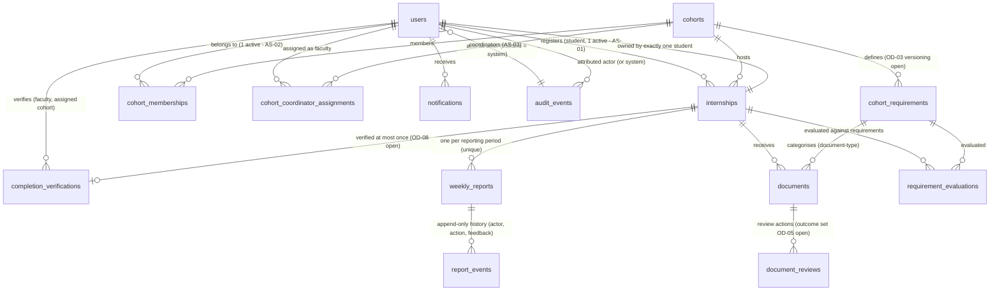

# InternFlow Database Design Document (DDD)

**Project:** InternFlow

## 1. Document Control

| Field | Value |
|---|---|
| Document Title | InternFlow Database Design Document (DDD) |
| Project Name | InternFlow |
| Document Identifier | IF-DOC-DDD-001 |
| Version | 1.0 |
| Status | Draft — Pending Review (not approved) |
| Last Updated | 2026-10-17 |
| Purpose | Define the initial PostgreSQL data model for the InternFlow MVP: entity inventory, table definitions, relationships and cardinality, constraints and indexes, transaction and concurrency expectations, and audit/compliance/storage data structures — derived from and traceable to the PRD, FRD, and SRS, while preserving unresolved domain decisions. |
| Related Source Documents | PRD v1.0 — `docs/requirements/PRD.md` (baseline commit `9f91303`); FRD v1.0 — `docs/requirements/FRD.md` (commit `c8b8754`); SRS v1.0 — `docs/requirements/SRS.md` (commit `7ffeecc`). Companion deliverables: `docs/architecture/SAD.md` (System Architecture Document), `docs/architecture/DECISIONS.md`. |
| Intended Audience | Project reviewer/stakeholder; the development team; authors of the API Specification, Security Requirements, and Test Plan. |

**Review note:** This document is a draft pending human review and must not be treated as approved. **No migrations are created and no schema changes are executed in this substage.** This document resolves no open decision; where the source documents leave a domain question open, the alternatives and the decision needed are recorded instead of a choice being made silently.

**Status conventions** (consistent with FRD §2.4 and SRS §2.6): **Confirmed** (established by PRD/FRD/SRS, source cited), **Derived** (follows necessarily; flagged for review), **Proposed** (a physical schema choice this document offers because a schema must exist; requires review), **Open decision (OD-xx)** (FRD §9, carried unchanged), **Assumption (AS-xx)** (FRD §9.3; not approved). Where a formerly **Proposed** item was approved at the Stage 1.6 planning review it is labeled **Approved** (IF-DEC-xx), with its boundaries recorded in `DECISIONS.md` §5; approval is an architectural direction, not a requirements-baseline promotion. Confirmed domain requirements are stated separately from proposed physical choices wherever they could be confused.

## Table of Contents

- [1. Document Control](#1-document-control)
- [2. Database Design Principles](#2-database-design-principles)
- [3. Domain Model and Entity Inventory](#3-domain-model-and-entity-inventory)
- [4. Entity Definitions](#4-entity-definitions)
- [5. Relationships and Cardinality](#5-relationships-and-cardinality)
- [6. Weekly Reports and Review History](#6-weekly-reports-and-review-history)
- [7. Documents and File Metadata](#7-documents-and-file-metadata)
- [8. Compliance and Completion Data](#8-compliance-and-completion-data)
- [9. Audit History](#9-audit-history)
- [10. Keys, Constraints, and Indexes](#10-keys-constraints-and-indexes)
- [11. Transaction and Concurrency Considerations](#11-transaction-and-concurrency-considerations)
- [12. Data Integrity, Privacy, and Security](#12-data-integrity-privacy-and-security)
- [13. Data Dictionary and ER Model](#13-data-dictionary-and-er-model)
- [14. Traceability](#14-traceability)

## 2. Database Design Principles

| # | Principle | Application | Source |
|---|---|---|---|
| D1 | Relational data modeling | The domain is entities with explicit relationships: users, cohorts, internships, reports, documents, requirements, evaluations, completions, notifications, audit events. PostgreSQL is the confirmed technology (PRD §11.2; SRS §3.4). | PRD §11.2; SRS-IF-06 |
| D2 | Referential integrity | Foreign keys on every relationship; no cascade deletion of internships, reports, documents, or cohorts (no-deletion policy). | FR-INT-008; NFR-DAT-001; SRS-DR-012; PR-08 / SRS-FR-009 |
| D3 | Appropriate normalization | One fact stored once: role on `users`; requirement definitions per cohort; approval attribution in review history with the current-cycle values on the report written in the same transaction. Denormalized copies appear only where documented with a consistency rule (§4.8, §4.7). | Derived; SRS §7.5 |
| D4 | Data consistency through transactions | Every workflow transition applies state + history + audit + compliance re-evaluation in one transaction; failed operations leave no partial state. | SRS-IF-09; NFR-REL-001/002 |
| D5 | Authorization-aware access patterns | Schema supports scope queries (own records; assigned cohort via membership/assignment chains; deployment-wide) so filters run in the data layer, not after retrieval. | FR-DASH-005; NFR-PERF-003; SRS-FR-007 |
| D6 | Auditability | Important actions recorded atomically with their action; audit rows append-only through application workflows; attribution never rewritten. | FR-AUDIT-001…005; NFR-AUD-001…004 |
| D7 | Transactional workflow changes | Report state changes are accepted only through defined transitions, executed server-side within a transaction. | FRD §5.2/§5.4; NFR-DAT-003 |
| D8 | Privacy and data minimization | No sensitive file content in relational columns; no notification of sensitive content; credential material minimized and never audited/logged; exported/derived views respect scope. | FR-DOC-007; FR-NOTIF-003; NFR-PRV-001…004 |
| D9 | Maintainability | Consistent naming conventions (§2.1); no speculative tables or indexes; schema expresses confirmed requirements, and open decisions are marked where they will alter the schema. | NFR-MNT-001/003 |
| D10 | No invented policies | No retention durations, deadline values, file limits, or compliance thresholds are encoded as schema defaults or constraints. | PRD §18; FRD §2.4; SRS §14.3 |

### 2.1 Naming conventions (Proposed physical choices)

- Tables: `snake_case`, plural (`weekly_reports`, `audit_events`).
- Columns: `snake_case`; surrogate primary key `id` (`BIGINT`, database-generated) unless noted.
- Timestamps: `timestamptz` (stored UTC — Proposed); date-only values use `date`.
- Enumerated values: `text` columns with `CHECK` constraints (chosen over native PostgreSQL enum types for easier evolution when open decisions resolve — Proposed).
- Foreign keys: `<referenced_table>_id`.
- Every table carries `created_at` (and `updated_at` where mutable); audit/history tables use explicit event timestamps instead.
- Physical type and default choices in this document are **Proposed** schema decisions; the domain rules they enforce are cited separately as Confirmed/Derived.

## 3. Domain Model and Entity Inventory

Derived from the PRD scope (PRD §7.1), the FRD functional requirements (FRD §6), and the SRS conceptual model (SRS §8.1). Each candidate is evaluated; not every concept becomes a table.

| # | Entity (table) | Purpose | Classification | Source |
|---|---|---|---|---|
| 1 | `users` | Accounts, single role, account/activation status, credential reference. | **Required** | PRD §7.1.2; FR-USER-001…008 |
| 2 | `cohorts` | Cohort identity, applicable period, deadline configuration, status. | **Required** | PRD §7.1.4; FR-COHORT-001/005 |
| 3 | `cohort_memberships` | Student ↔ cohort assignment history (one active membership per student). | **Required** (concept); table representation **Proposed** — alternative in §4.3 | FR-COHORT-002; AS-02; OD-14 |
| 4 | `cohort_coordinator_assignments` | Faculty Coordinator ↔ cohort scope assignments, with primary-coordinator flag. | **Required** | FR-COHORT-003; FR-USER-007; AS-03 |
| 5 | `cohort_requirements` | Requirement definitions per cohort: type, description, mandatory/optional flag, evaluation-rule mapping. Document categories are represented as document-type requirements. | **Required** (concept); versioning columns **Open** (OD-03) | FR-COHORT-004; FR-DOC-001; SRS-DR-011 |
| 6 | `internships` | One internship record per student placement: student, cohort, dates, descriptive details, lifecycle anchors. | **Required** | PRD §7.1.3; FR-INT-001…008; AS-01; OD-12 |
| 7 | `weekly_reports` | One report record per internship per reporting period, carrying state, work-log content, and cycle timestamps. | **Required** | PRD §7.1.6; FR-REPORT-001…010; FRD §5 |
| 8 | `report_events` | Append-only review/submission history: action type, actor, timestamp, feedback. | **Required** | FR-REVIEW-002/006; FR-AUDIT-001 |
| 9 | `documents` | Document metadata for submitted files; references private object storage; never file content. | **Required** | PRD §7.1.5; FR-DOC-002/007; SRS §8.1 |
| 10 | `document_reviews` | Append-only record of faculty document-review actions (actor, timestamp, outcome, feedback). | **Recommended** — outcome vocabulary **Open** (OD-05) | FR-DOC-005 |
| 11 | `requirement_evaluations` | Persisted per-requirement compliance evaluation per internship (the single derived compliance source). | **Required** (persisted derivation **Approved** — IF-DEC-13, bounded); status vocabulary partly **Open** (OD-04) | FR-COMP-001/002/007; SRS-DR-… (§8.1); NFR-PERF-004 |
| 12 | `completion_verifications` | The verification record: internship, verifier, timestamp, requirement-results snapshot. | **Required**; cardinality **Open** (OD-08) | FR-COMPLETE-003/008; SRS-DR-007 |
| 13 | `notifications` | Per-recipient in-app notification with read status and email delivery status. | **Required** | PRD §7.1.10; FR-NOTIF-004/005/007 |
| 14 | `audit_events` | Immutable (application-level) record of important actions: event type, actor/system, entity, timestamp, before/after values. | **Required**; event set partly **Open** (OD-06) | PRD §7.1.12; FR-AUDIT-001…005 |

**Concepts deliberately not given a table:**

| Concept | Why no table | Source |
|---|---|---|
| Roles / permission matrix | Single role stored on `users` (AS-04); permissions are code configuration (Spring Security), not data — except cohort scope assignments, which are entity #4. | AS-04; FR-USER-007 |
| Document file content | Held in private object storage; only a storage reference is stored. | FR-DOC-007; SRS §8.1 |
| Overall compliance status | Derived by aggregating `requirement_evaluations` rows for an internship — no second stored status that could diverge (§8). | FR-COMP-007; NFR-DAT-006 |
| Reports/CSV exports | Computed queries over existing entities; CSVs are generated, not persisted. Export events may appear in `audit_events` only if OD-06 adopts export auditing. | FR-EXPORT-001/008 |
| Deadlines | Configuration values on `cohorts` (§4.2), not an entity; no deadline values are invented (OD-10). | FR-COHORT-005; OD-10 |
| Company Mentor, attendance, analytics | Post-MVP; no schema is designed for them. | PRD §7.2/§16; SRS-FR-002 |
| Notification templates | MVP messages are fixed content composed by the application; no template entity is required. | Derived from FR-NOTIF-003 |

## 4. Entity Definitions

Types below are proposed physical choices unless noted. "Conf." column marks whether the field's existence is a confirmed domain requirement or a proposed schema detail.

### 4.1 `users`

Purpose: store accounts, their single MVP role, and account status; the identity record referenced by every other entity as actor or owner. (PRD §7.1.2; FR-USER-001…008)

| Column | Type | Null | Constraints | Conf. | Notes / source |
|---|---|---|---|---|---|
| `id` | bigint | No | PK | Proposed | Surrogate key. |
| `identity` | text | No | UNIQUE | Conf. | Unique email/username (FR-USER-001). Exact identity model was part of **OD-15**; **email address as the login identity was approved 2026-10-18 (IF-DEC-19)**. |
| `display_name` | text | No | — | Conf. | FR-USER-001. |
| `role` | text | No | CHECK `role IN ('STUDENT','FACULTY_COORDINATOR','COLLEGE_ADMINISTRATOR')` | Conf. (values) / Proposed (type) | Three MVP roles only (FR-USER-002); single role per user (**AS-04**) — a combined-role future would require a schema change (flagged, not designed). |
| `account_status` | text | No | DEFAULT `'ACTIVE'`; CHECK `IN ('ACTIVE','DEACTIVATED')` | Conf. (concept) | Deactivation preserves all records/attribution; no deletion (FR-USER-005, PR-08). |
| `activation_state` | text | No | DEFAULT `'PENDING'`; CHECK `IN ('PENDING','ACTIVATED')` | Approved (IF-DEC-19, 2026-10-18) | Creation is distinct from activation; unactivated accounts cannot sign in (FR-USER-001, FR-AUTH-001 AC4). Mechanics approved: administrator-set temporary password with mandatory change at first login (IF-DEC-19, closing OD-15). |
| `credential_hash` | text | Yes | — | Approved (IF-DEC-19, 2026-10-18) | BCrypt hash; nullable until the temporary credential is set/activated. Policy: minimum 12 characters, no mandatory character classes (IF-DEC-19). Sensitive: never logged/audited (§12). |
| `contact_email` | text | Yes | — | Proposed (PR-06) | Notification target (FR-NOTIF-005) — may equal `identity`; separation is a proposed self-service field (PR-06). |
| `contact_phone` | text | Yes | — | Proposed (PR-06) | Optional profile field. |
| `created_at` | timestamptz | No | — | Proposed | |
| `updated_at` | timestamptz | No | — | Proposed | |

- **Keys/constraints:** PK `id`; UNIQUE `identity`; role and status CHECKs.
- **Indexes:** UNIQUE(identity) serves sign-in lookup; `role` index only if role-filtered listings show measurable need (not added speculatively).
- **Sensitive data:** `credential_hash` (if used) is credential material — excluded from all DTOs, logs, and audit payloads (§12). Open decisions affecting this table: **OD-01** (self-role-change/self-deactivation). (OD-15 was closed 2026-10-18 by IF-DEC-19.)
- **Deletion:** no MVP operation deletes users (FR-USER-005; PR-08 covers records; user deletion is an open question — FRD §4.2.2 marks it Open under OD-01).

### 4.2 `cohorts`

Purpose: cohort configuration — identity, applicable period, deadline values, lifecycle status. (PRD §7.1.4; FR-COHORT-001/005/007)

| Column | Type | Null | Constraints | Conf. | Notes / source |
|---|---|---|---|---|---|
| `id` | bigint | No | PK | Proposed | |
| `cohort_code` | text | No | UNIQUE | Conf. (concept) | Duplicate cohort identifier rejected (FR-COHORT-001). |
| `name` | text | No | — | Conf. | FR-COHORT-001 (identifier/name). |
| `period_start`, `period_end` | date | Yes | CHECK `period_end >= period_start` when both present | Proposed | "Applicable period" (FR-COHORT-001); exact semantics not specified by the PRD. |
| `deadline_config` | jsonb | Yes | — | Proposed / **OD-10** | Holds configured deadline values surfaced for display/notifications (FR-COHORT-005). **No default values are encoded**; late-submission semantics are **OD-10**; schema shape revisited when OD-10 resolves. |
| `status` | text | No | DEFAULT `'ACTIVE'`; CHECK `IN ('ACTIVE','INACTIVE')` | Proposed | Deactivation replaces deletion; cohorts referenced by internships cannot be removed (FR-INT-008 AC2, PR-08). |
| `created_at`, `updated_at` | timestamptz | No | — | Proposed | |
| `created_by`, `updated_by` | bigint | Yes | FK → `users` | Proposed | Attribution for configuration changes (FR-AUDIT-002 also records the event). |

- **Relationships:** 1→* memberships, coordinator assignments, requirements, internships.
- **Open:** requirement scope/attributes and change propagation (**OD-03**); deadline values/semantics (**OD-10**); membership moves (**OD-14**).

### 4.3 `cohort_memberships`

Purpose: record that a student belongs to a cohort; enforce at most one active membership per student (**AS-02**); optionally preserve membership history for future **OD-14** decisions. (FR-COHORT-002)

| Column | Type | Null | Constraints | Conf. | Notes / source |
|---|---|---|---|---|---|
| `id` | bigint | No | PK | Proposed | |
| `student_user_id` | bigint | No | FK → `users` (`ON DELETE RESTRICT`) | Conf. | Student member. |
| `cohort_id` | bigint | No | FK → `cohorts` (`ON DELETE RESTRICT`) | Conf. | |
| `joined_at` | timestamptz | No | — | Conf. (concept) | Assignment event `cohort.member_added` (FR-COHORT-002). |
| `left_at` | timestamptz | Yes | — | Proposed | Active membership = `left_at IS NULL`. Enables history if **OD-14** permits moves; no move operation exists in the MVP (FR-COHORT-002). |
| `created_by` | bigint | Yes | FK → `users` | Proposed | Administrator performed assignment. |

- **Constraints/indexes:** partial UNIQUE `(student_user_id) WHERE left_at IS NULL` — enforces **AS-02** at persistence (**Proposed**, assumption-dependent: if reviewers reject AS-02 this constraint is removed).
- **Alternative representation (documented, not chosen):** a nullable `cohort_id` column on `users`. Rejected in favor of this table because membership must exist independently of internships (FR-INT-001 requires cohort membership *before* registration), and because `left_at` history supports the future **OD-14** decision without a new table. Final approval belongs to human review.

### 4.4 `cohort_coordinator_assignments`

Purpose: establish each Faculty Coordinator's record scope; a coordinator with no active assignment has no students (FR-USER-007). (FR-COHORT-003)

| Column | Type | Null | Constraints | Conf. | Notes / source |
|---|---|---|---|---|---|
| `id` | bigint | No | PK | Proposed | |
| `cohort_id` | bigint | No | FK → `cohorts` | Conf. | |
| `faculty_user_id` | bigint | No | FK → `users` | Conf. | Target must hold the Faculty Coordinator role (service-layer check, FR-COHORT-003). |
| `is_primary` | boolean | No | DEFAULT `false` | Proposed / **AS-03** | One primary coordinator per cohort is the **assumption**; additional coordinators are a permitted extension (FR-COHORT-003 "one or more"; **AS-03** not yet confirmed). At most one `is_primary = true` per cohort would be enforced by a partial unique index if AS-03 is confirmed. |
| `assigned_at` | timestamptz | No | — | Conf. (concept) | `cohort.coordinator_assigned` with before/after values (FR-COHORT-003, FR-AUDIT-001). |
| `assigned_by` | bigint | Yes | FK → `users` | Proposed | Administrator. |
| `unassigned_at` | timestamptz | Yes | — | Proposed | Removal withdraws scope for future requests (FR-COHORT-003). |

- **Constraints/indexes:** partial UNIQUE `(cohort_id, faculty_user_id) WHERE unassigned_at IS NULL`; partial unique primary-flag index (**Proposed**, pending AS-03).
- **Open:** who besides an administrator may participate in assignment (**OD-01**); cardinality confirmation (**AS-03**).

### 4.5 `cohort_requirements`

Purpose: the requirement set configured per cohort and applied to its internships — the input to compliance evaluation and completion eligibility. Each requirement has an identifier, description, mandatory/optional flag, and a type mapping to a supported evaluation rule. (FR-COHORT-004; SRS-DR-011)

| Column | Type | Null | Constraints | Conf. | Notes / source |
|---|---|---|---|---|---|
| `id` | bigint | No | PK | Proposed | |
| `cohort_id` | bigint | No | FK → `cohorts` | Conf. | |
| `name` | text | No | — | Conf. | Requirement identifier/description (FR-COHORT-004). |
| `description` | text | Yes | — | Conf. | FR-COHORT-004. |
| `requirement_type` | text | No | CHECK `IN ('DOCUMENT_SUBMISSION','APPROVED_REPORT_PER_PERIOD')` | Conf. (limited set) / Proposed (values) | Types must map to evaluation rules supported by FR-COMP-003/004/005; other types added only by decision (FR-COHORT-004). A third value for "other types" is deliberately **not** invented. |
| `is_mandatory` | boolean | No | — | Conf. | Mandatory/optional flag; only mandatory requirements block compliance/completion (FR-COHORT-004, FR-COMP-002). |
| `config` | jsonb | Yes | — | Proposed / **OD-03** | Type-specific attributes (e.g., document category label for `DOCUMENT_SUBMISSION`; period scope for `APPROVED_REPORT_PER_PERIOD`). Attribute catalogue is **OD-03/OD-05**; no invented catalogue. |
| `version` | integer | No | DEFAULT `1` | Proposed / **OD-03** | Placeholder for the versioning model. Whether requirement changes are versioned vs. grandfathered vs. retroactive is **OD-03** — this column's semantics are deliberately undecided. |
| `superseded_at` | timestamptz | Yes | — | Proposed / **OD-03** | As above. |
| `created_at`, `updated_at` | timestamptz | No | — | Proposed | |
| `created_by`, `updated_by` | bigint | Yes | FK → `users` | Proposed | Configuration attribution (FR-AUDIT-001 `requirement.created/updated`). |

- **Constraints:** CHECK `is_mandatory IS NOT NULL` (implicit NOT NULL); UNIQUE `(cohort_id, name)` (**Proposed**).
- **Open:** configurable attribute scope, ownership beyond administrator, change propagation (**OD-03**); document catalogue (**OD-05/OD-03**); report periods require the reporting schedule (**OD-10**) before `APPROVED_REPORT_PER_PERIOD` requirements can enumerate periods (FR-COMP-003 note).

### 4.6 `internships`

Purpose: the internship record of a student within a cohort; the anchor for reports, documents, evaluations, and completion. (PRD §7.1.3; FR-INT-001…008)

| Column | Type | Null | Constraints | Conf. | Notes / source |
|---|---|---|---|---|---|
| `id` | bigint | No | PK | Proposed | |
| `student_user_id` | bigint | No | FK → `users` | Conf. | Exactly one student (FR-INT-002, SRS-DR-002). |
| `cohort_id` | bigint | No | FK → `cohorts` | Conf. | Exactly one cohort (FR-INT-002). |
| `start_date` | date | No | — | Conf. | FR-INT-003. |
| `end_date` | date | No | CHECK `end_date >= start_date` | Conf. (rule) / Proposed (constraint) | Invalid ranges rejected (FR-INT-003; equal dates allowed). |
| `title` | text | Yes | — | Proposed / **OD-12** | "Descriptive details identifying the internship" (FR-INT-001). The full field catalogue beyond student/cohort/dates/details is **OD-12** — additional columns are deliberately not invented. |
| `description` | text | Yes | — | Proposed / **OD-12** | As above. |
| `lifecycle_state` | text | No | DEFAULT `'REGISTERED'`; CHECK `IN ('REGISTERED','VERIFIED_COMPLETE')` (interim) | Conf. (two anchors) / Proposed (interim values) | Only two anchor states are established: registration and verified completion (FR-INT-004). The full state set is **OD-12**; the CHECK is an interim constraint that will be extended if OD-12 defines more states. |
| `created_at`, `updated_at` | timestamptz | No | — | Proposed | |
| `created_by` | bigint | Yes | FK → `users` | Proposed | Student owner (FR-INT-001). |

- **Constraints/indexes:** partial UNIQUE `(student_user_id) WHERE lifecycle_state = 'REGISTERED'` — enforces **AS-01** (at most one active internship) at persistence (**Proposed**, interim definition of "active" pending **OD-12**); FKs RESTRICT; date CHECK.
- **Consistency rule (Proposed):** `lifecycle_state = 'VERIFIED_COMPLETE'` must be written in the same transaction that creates the row in `completion_verifications` (§4.11), so the two never diverge (FR-COMPLETE-003, NFR-DAT-006).
- **Unresolved nuance for human review:** whether a student may register a *new* internship after the first is verified complete is not addressed by the source documents (AS-01 speaks of "one active internship"; FR-INT-002 AC1 rejects a second internship "while one exists"). The interim constraint above permits a new registration after verification; this behavior needs confirmation (**OD-01/OD-12/OD-13** interplay).
- **Open:** field catalogue (**OD-12**); reassignment/transfer (**OD-13** — no reassignment columns or operations exist).

### 4.7 `weekly_reports`

Purpose: one report record per internship per reporting period, reused through all states; holds work-log content and the current-cycle timestamps. (PRD §7.1.6; FR-REPORT-001…010; FRD §5)

| Column | Type | Null | Constraints | Conf. | Notes / source |
|---|---|---|---|---|---|
| `id` | bigint | No | PK | Proposed | |
| `internship_id` | bigint | No | FK → `internships` | Conf. | Exactly one internship (SRS-DR-005). |
| `reporting_period` | text | No | UNIQUE `(internship_id, reporting_period)` | Conf. (uniqueness) / Proposed (format) | At most one report per internship-period in **any** state, enforced atomically at persistence (FR-REPORT-006, SRS-DR-010, SRS-IF-08). Period format (e.g., ISO week label or period start date) is a **Proposed** representation; the cadence itself is **OD-10** (FR-REPORT-001 notes calendar week as the working interpretation). |
| `state` | text | No | DEFAULT `'DRAFT'`; CHECK `state IN ('DRAFT','SUBMITTED','CORRECTION_REQUESTED','RESUBMITTED','APPROVED')` | Conf. (five values) / Proposed (constraint) | Exactly five states; no others exist (FRD §5.1; SRS-WF-006). |
| `content` | text | Yes | — | Conf. (requirement at submission) | Work-log content (FR-REPORT-002). Nullable while `DRAFT`; presence and non-emptiness are enforced at Submit/Resubmit in the service layer (cannot be expressed as a simple state-dependent check without a trigger — service layer + tests, §10). |
| `submitted_at` | timestamptz | Yes | — | Conf. | Set on T1; original timestamp preserved on duplicate submit (T8 idempotency, FR-REPORT-006). |
| `resubmitted_at` | timestamptz | Yes | — | Conf. | Set on T4 (FR-REPORT-008). |
| `approved_at` | timestamptz | Yes | — | Conf. | Set on T3/T6 (FRD §5.2). |
| `approved_by` | bigint | Yes | FK → `users` | Conf. | Approver identity (FR-REVIEW-004). Written in the same transaction as the `APPROVED` row in `report_events` (consistency rule, §6) — current-cycle convenience, history remains authoritative. |
| `created_at`, `updated_at` | timestamptz | No | — | Proposed | |

- **Constraints/indexes:** UNIQUE `(internship_id, reporting_period)`; state CHECK; index on `(state)` for review-queue support and `(internship_id)` for per-internship reads (**Proposed** with query justification: FR-REVIEW-001 queue, FR-REPORT-007 views).
- **Content versioning:** report content is revised in place (FRD §5.1 note); prior content versions are **not** retained in the MVP — retention/versioning is **OD-11** (FR-DOC-004's parallel rule).
- **Sensitive data:** report content is student work data — scope-restricted at query time (§5); never included in notifications beyond references (FR-NOTIF-003).

### 4.8 `report_events`

Purpose: append-only history of the report's workflow — every submission, correction request, resubmission, and approval with actor and timestamp — satisfying review history (FR-REVIEW-006) and supporting authorization and auditability. (FR-REVIEW-002/006; FR-AUDIT-001)

| Column | Type | Null | Constraints | Conf. | Notes / source |
|---|---|---|---|---|---|
| `id` | bigint | No | PK | Proposed | Also serves as the notification occurrence reference (§4.12). |
| `report_id` | bigint | No | FK → `weekly_reports` | Conf. | |
| `action_type` | text | No | CHECK `IN ('SUBMITTED','CORRECTION_REQUESTED','RESUBMITTED','APPROVED')` | Conf. (concept) / Proposed (values) | The four attributable action types of the lifecycle; matches FR-REVIEW-006 AC1 (submit → correction → resubmit → approve all visible in history). |
| `actor_user_id` | bigint | No | FK → `users` | Conf. | Attribution is mandatory; history readable even if the actor is later deactivated (FR-REVIEW-006, FR-AUDIT-003). |
| `occurred_at` | timestamptz | No | — | Conf. | Actual event time (SRS-DR-015). |
| `feedback` | text | Yes | CHECK: NOT NULL and non-blank when `action_type = 'CORRECTION_REQUESTED'` (**Proposed** expression) | Conf. (feedback required for corrections) | FR-REVIEW-003 requires non-empty feedback; enforced at persistence as a defensive backstop beyond the service check. |

- **Immutability:** append-only through application workflows; no update/delete operation exists for any role (FR-REVIEW-006 AC2, NFR-DAT-005). Application-level enforcement confirmed; database-level write protection is a **Recommendation** (SAD §14).
- **Indexes:** `(report_id, occurred_at)` for ordered history reads (FR-REVIEW-006); no speculative others.
- **Open:** whether denied/failed attempts are recorded anywhere (**OD-06**) — they are *not* written here by default.

### 4.9 `documents`

Purpose: metadata for a submitted document, referencing content in private object storage; never the content itself. (PRD §7.1.5; FR-DOC-001…008; SRS §8.1)

| Column | Type | Null | Constraints | Conf. | Notes / source |
|---|---|---|---|---|---|
| `id` | bigint | No | PK | Proposed | Document identifier (FR-DOC-002). |
| `internship_id` | bigint | No | FK → `internships` | Conf. | Related workflow entity (FR-DOC-002). |
| `requirement_id` | bigint | No | FK → `cohort_requirements` | Conf. (concept) / Proposed (representation) | The document category: required categories per cohort map to requirements (FR-DOC-001). Integrity rule (Proposed, service-enforced): `cohort_requirements.cohort_id` must equal the internship's `cohort_id`. Catalogue remains **OD-03/OD-05**. |
| `uploading_user_id` | bigint | No | FK → `users` | Conf. | Submitting user (FR-DOC-002). |
| `original_filename` | text | No | — | Conf. (concept) | FR-DOC-002 metadata. |
| `storage_key` | text | No | UNIQUE | Proposed | Opaque object-storage reference; not a user-supplied path and never a public URL (FR-DOC-007, SAD §12). |
| `size_bytes` | bigint | No | CHECK `size_bytes > 0` | Conf. (concept) | FR-DOC-002/003; validated against a configurable limit — **no limit value stored here or invented** (**OD-16** policy lives in configuration). |
| `content_type` | text | No | — | Conf. (concept) | FR-DOC-002/003; validated against a configurable allowlist (**OD-16**). |
| `status` | text | No | DEFAULT `'SUBMITTED'`; CHECK `IN ('SUBMITTED','REVIEWED')` (interim) | Conf. (three-value concept) / Proposed (interim) | FR-DOC-006 exposes not-submitted / submitted / reviewed. The **outcome set within "reviewed" is OD-05**; this interim CHECK will be extended when OD-05 resolves. Invalid uploads never produce a row (FR-DOC-002/003). |
| `reviewed_by` | bigint | Yes | FK → `users` | Conf. (concept) | Most recent review actor (FR-DOC-005). |
| `reviewed_at` | timestamptz | Yes | — | Conf. (concept) | FR-DOC-005. |
| `submitted_at` | timestamptz | No | — | Conf. | FR-DOC-002. |
| `replaced_at` | timestamptz | Yes | — | Conf. (concept) | Replacement updates file + timestamp; permitted only while no review action is recorded (interim rule, FR-DOC-004, **OD-05**). Prior file content is not retained (**OD-11**). |
| `created_at`, `updated_at` | timestamptz | No | — | Proposed | |

- **Constraints/indexes:** UNIQUE `storage_key`; FKs RESTRICT; index `(internship_id)` for per-internship document views (FR-DOC-006).
- **Sensitive data:** the file itself is sensitive and private (§7, §12); metadata visibility follows the same scope rules as content (FR-DOC-007).
- **Open:** admin access to content (**OD-01**); review outcomes and compliance effect (**OD-05**); file policies (**OD-16**).

### 4.10 `document_reviews` (Recommended)

Purpose: append-only record of document review actions with actor and timestamp, as required by FR-DOC-005, without overloading `documents` with a single review slot when repeated or future outcomes may apply. (FR-DOC-005; dependent on **OD-05**)

| Column | Type | Null | Constraints | Conf. | Notes / source |
|---|---|---|---|---|---|
| `id` | bigint | No | PK | Proposed | |
| `document_id` | bigint | No | FK → `documents` | Conf. | |
| `actor_user_id` | bigint | No | FK → `users` | Conf. | Assigned Faculty Coordinator only (service-enforced, FR-DOC-005). |
| `occurred_at` | timestamptz | No | — | Conf. | Timestamped recording (FR-DOC-005). |
| `outcome` | text | Yes | — | **Open (OD-05)** | The review-outcome set (e.g., accepted vs. corrections requested) is undecided; the column exists in design only, with **no value set invented**. |
| `feedback` | text | Yes | — | Conf. (concept) | "Any feedback provided" (FR-DOC-005). |

- Classification: **Recommended** — FR-DOC-005 requires recording review actions with actor and timestamp; whether multiple reviews/history are visible (and their outcomes) depends on **OD-05**. If OD-05 confirms only a single latest review, the `documents.reviewed_by/reviewed_at` columns alone would suffice and this table can be dropped. This is a decision point for review.

### 4.11 `completion_verifications`

Purpose: the record proving completion was verified — internship, verifier, timestamp, and the evaluated requirement results at verification time. (FR-COMPLETE-003/008; SRS-DR-007)

| Column | Type | Null | Constraints | Conf. | Notes / source |
|---|---|---|---|---|---|
| `id` | bigint | No | PK | Proposed | |
| `internship_id` | bigint | No | UNIQUE FK → `internships` | Conf. (one record per verification action; interim unique) | Completion belongs to exactly one internship (SRS-DR-007). **UNIQUE is interim:** if **OD-08** requires multiple approvers, the constraint changes to support multiple rows per internship — flagged, not decided. |
| `verified_by_user_id` | bigint | No | FK → `users` | Conf. | The verifying Faculty Coordinator (assigned cohort — service-enforced, FR-COMPLETE-002). Administrator verification is **OD-08** and not granted by default. |
| `verified_at` | timestamptz | No | — | Conf. | FR-COMPLETE-003. |
| `requirement_results_snapshot` | jsonb | No | — | Conf. (content) / Proposed (format) | The evaluated requirement results at verification (FR-COMPLETE-003): per-requirement status, requirement ids/versions, aggregate counts. JSONB snapshot chosen over a child table (**Proposed**) because the snapshot is read-only evidence; a child table `completion_result_lines` is the alternative if structured querying is required — decision for review. |
| `created_at` | timestamptz | No | — | Proposed | |

- **Immutability:** append-only; no reversal operation exists (verified completion is immutable in the MVP — FR-COMPLETE-005, SRS-WF-022; reversal is **OD-08**).
- **Open:** multi-approver requirement and admin authority (**OD-08**).
- **Sensitive data:** snapshot contains status data only — no document content, no personal payloads beyond references (data minimization, §12).

### 4.12 `notifications`

Purpose: per-recipient in-app notification rows with read status and email delivery tracking. (PRD §7.1.10; FR-NOTIF-001…007)

| Column | Type | Null | Constraints | Conf. | Notes / source |
|---|---|---|---|---|---|
| `id` | bigint | No | PK | Proposed | |
| `recipient_user_id` | bigint | No | FK → `users` | Conf. | Resolved from record relationships, never user input (FR-NOTIF-002, SRS-FR-006). |
| `event_type` | text | No | — | Conf. (events) / No CHECK | Confirmed trigger set in FR-NOTIF-001; the full list is **OD-09**, so **no CHECK constraint is defined** that would block adopted future events. |
| `source_entity_type` | text | No | — | Proposed | e.g., `REPORT`, `DOCUMENT`, `COMPLETION`, `USER` (FR-NOTIF-003 record reference). |
| `source_entity_id` | bigint | No | — | Proposed | The affected record id. |
| `occurrence_id` | bigint | No | — | Proposed | Identifies the specific occurrence — the originating history row (e.g., `report_events.id` for correction cycles, which repeat on the same report) or the record id where a single occurrence exists. |
| `message` | text | No | — | Conf. | Concise message with event type, record reference, timestamp; **no sensitive document content** (FR-NOTIF-003, NFR-PRV-003). |
| `created_at` | timestamptz | No | — | Conf. | Event timestamp surfaced (FR-NOTIF-003). |
| `read_at` | timestamptz | Yes | — | Conf. | Per-recipient read status (FR-NOTIF-007); null = unread. |
| `email_status` | text | No | DEFAULT `'PENDING'`; CHECK `IN ('PENDING','SENT','FAILED')` | Proposed | Records email outcome for operational visibility (FR-NOTIF-006 "failure is recorded"). **No retry count, schedule, or guarantee is encoded** (**OD-09**). |
| `email_attempted_at` | timestamptz | Yes | — | Proposed | Attempt timestamp; not a delivery guarantee. |

- **Constraints/indexes:** **duplicate prevention (Proposed mechanism):** UNIQUE `(event_type, source_entity_type, source_entity_id, occurrence_id, recipient_user_id)` — implements "at most one notification per event occurrence per recipient" (FR-NOTIF-007, NFR-REL-006). Indexes: `(recipient_user_id, created_at DESC)` for list views (FR-NOTIF-007); `(recipient_user_id, read_at)` for unread counts (**Proposed**, justified by dashboard unread display if adopted).
- **Privacy:** rows are private to the recipient; no cross-user access paths exist (FR-NOTIF-004). Retention tied to **OD-11** (no purge in MVP; no duration asserted).

### 4.13 `audit_events`

Purpose: immutable record of important actions and decisions for traceability. (PRD §7.1.12; FR-AUDIT-001…006)

| Column | Type | Null | Constraints | Conf. | Notes / source |
|---|---|---|---|---|---|
| `id` | bigint | No | PK | Proposed | |
| `event_type` | text | No | — | Conf. (required set) / No CHECK | Required confirmed set in §9; extended set pending **OD-06** — therefore no CHECK that would block adopted events. |
| `actor_user_id` | bigint | Yes | FK → `users` | Conf. | NULL for system-originated events (FR-AUDIT-003). Attribution persists even after deactivation — FK must not cascade (FR-USER-005, NFR-DAT-007). |
| `actor_kind` | text | No | CHECK `IN ('USER','SYSTEM')`; CHECK consistency with `actor_user_id` non-null for `'USER'` (**Proposed** expression) | Conf. (concept) | System events explicitly marked (FR-AUDIT-003). |
| `entity_type` | text | No | — | Conf. | e.g., `REPORT`, `USER`, `COHORT`, `REQUIREMENT`, `COMPLETION` (FR-AUDIT-002). |
| `entity_id` | bigint | No | — | Conf. | Affected entity identifier. Polymorphic reference: **no FK is possible** across entity types — referential correctness is guaranteed by the writing service (documented limitation, §10). |
| `before_values` | jsonb | Yes | — | Conf. (where applicable) | FR-AUDIT-002 (role changes, requirement changes, coordinator assignment). |
| `after_values` | jsonb | Yes | — | Conf. (where applicable) | As above. Content-level events store references/state transitions, **not** full document or report content (FR-AUDIT-002). |
| `occurred_at` | timestamptz | No | — | Conf. | Actual time (SRS-DR-015). |
| `correlation_id` | text | Yes | — | Proposed | Request/operation correlation for diagnostics; justified for tracing one user action across state + audit rows; not required by the FRD. |

- **Immutability:** application-level update/delete is forbidden for all roles (FR-AUDIT-005; explicit admin denial is a Proposed strengthening). Database-level protection (e.g., revoked UPDATE/DELETE privileges) is a **Recommendation** (SAD §14).
- **Retention:** **none asserted** — no duration, purge, or archival is designed; MVP implements no purge operation (FR-AUDIT-006; **OD-11**). Immutability, retention, and visibility are separate concerns (§9).
- **Visibility:** viewer mapping pending **OD-06** (proposal: admin deployment-wide, faculty assigned-cohort, students denied).
- **Sensitive data:** before/after values must never contain credential material, tokens, or document content (§12; FR-AUDIT-002).

## 5. Relationships and Cardinality

### 5.1 Summary table

| Relationship | Cardinality | Basis | Status |
|---|---|---|---|
| user (student) → internships | 0..1 **active** internship at a time | **AS-01** / FR-INT-002 | Assumption — partial unique index Proposed (§4.6); second internship after verification unsettled (§4.6, human review) |
| user (student) → cohort membership | exactly 1 active cohort at a time | **AS-02** / FR-COHORT-002 | Assumption — partial unique index Proposed (§4.3) |
| cohort → coordinator assignments | 1..* coordinators; one *primary* per cohort | FR-COHORT-003 ("one or more") + **AS-03** | Mixed: multiple assignments Confirmed; primary-cardinality Assumption pending confirmation; admin may assign/remove |
| cohort → requirements | 1..* requirement definitions | FR-COHORT-004 | Confirmed; versioning/propagation **OD-03** |
| cohort → internships | 1..* (via `internships.cohort_id`) | FR-INT-002, FR-INT-008 | Confirmed |
| student ↔ internship | exactly 1 student per internship | FR-INT-002 (SRS-DR-002) | Confirmed |
| internship → weekly_reports | 0..* ; **at most 1 per reporting period** | FR-REPORT-006 | Confirmed — UNIQUE constraint, atomic (SRS-DR-010); period definition **OD-10** |
| weekly_report → report_events | 0..* append-only entries | FR-REVIEW-006 | Confirmed |
| internship → documents | 0..* ; one active metadata row per requirement/category at a time (replacement updates in place) | FR-DOC-002/004 | Confirmed mechanism; post-review replacement **OD-05** |
| document → document_reviews | 0..* (0..1 under interim single-review reading) | FR-DOC-005 | Recommended; outcome set **OD-05** |
| cohort_requirement → documents | 1..* documents reference one document-type requirement | FR-DOC-001 | Confirmed concept / Proposed representation |
| internship → requirement_evaluations | exactly 1 row per applicable requirement | FR-COMP-001/002 | Derived data — persistence **Approved** (IF-DEC-13, bounded; OD-04 open) |
| internship → completion_verifications | 0..1 (interim UNIQUE) | FR-COMPLETE-003 | Confirmed record per verification; multiplicity **OD-08** |
| user → notifications | 1..* as recipient | FR-NOTIF-004 | Confirmed |
| audit_events → actor user | 0..1 user (or system) | FR-AUDIT-003 | Confirmed |
| audit_events → affected entity | polymorphic (*..1 conceptually per entity) | FR-AUDIT-002 | Confirmed concept; no FK possible (§4.13) |

### 5.2 Explicitly preserved assumptions and constraints

- **AS-01 (assumption, not a confirmed requirement):** a student may have at most one active internship at a time. Enforced in the design by a *proposed* partial unique index and by service-layer validation (FR-INT-002). Confirmation required at review; PRD does not address multiple concurrent internships.
- **AS-02 (assumption):** a student may belong to one cohort at a time. Same enforcement pattern (FR-COHORT-002).
- **AS-03 (assumption):** a cohort has one primary Faculty Coordinator, with additional assignments as a permitted extension. The schema records `is_primary` but the cardinality rule is **not** converted into a confirmed constraint until AS-03 is confirmed (FR-COHORT-003).
- **Stage 1.6 review (2026-10-17):** AS-01, AS-02, and AS-03 were **accepted as working assumptions for the current architectural baseline** and remain **assumptions — not confirmed product requirements** (see `DECISIONS.md` §8). The dependent constraints therefore remain as designed here and are retained unchanged: C5 (`cohort_memberships`, AS-02) and C8 (`internships`, AS-01) stay marked assumption-dependent/Proposed in §10.1, and C6 (`cohort_coordinator_assignments`, sourced to FR-COHORT-003) likewise remains as designed for the AS-03 cardinality. None is promoted to a confirmed constraint, and none is removed or redesigned. The AS-01 wording ("at most one **active** internship") continues to permit historical internship records, and the AS-02 wording ("one cohort **at a time**") continues to permit historical membership/transfer records, per their respective partial unique indexes (`WHERE left_at IS NULL`, `WHERE lifecycle_state='REGISTERED'`). For AS-03, additional coordinator assignments remain supported as an extension without any invented permission or workflow behavior.
- **Faculty Coordinators alone approve weekly reports:** the schema supports this by making `report_events.action_type = 'APPROVED'` attributable to a `actor_user_id` whose cohort assignment is validated by the service layer on every approval; **no schema field grants approval rights to any role** — authority lives in authorization logic (FR-REVIEW-004/008; PRD §11.1).
- **Weekly-report uniqueness:** UNIQUE `(internship_id, reporting_period)` in any state, enforced at persistence so concurrent creations cannot both succeed (FR-REPORT-006; SRS-IF-08). The **reporting-period cadence remains OD-10** — only the uniqueness mechanism is designed, not the schedule.
- **Completion:** requires all mandatory requirements satisfied (`requirement_evaluations` all `SATISFIED` for mandatory rows, none `UNEVALUATED`) **and** an authorized verification record written by an assigned coordinator (FR-COMPLETE-001/002/004; PRD §11.1). Administrator authority remains **OD-08**; nothing in the schema grants it.

### 5.3 Unresolved cardinality (alternatives and decision needed)

| # | Question | Alternatives | Decision needed |
|---|---|---|---|
| 1 | Can a student hold a second internship after verification? | (a) Yes — as designed by the interim partial index; (b) No — unique over all internships per student. | Confirm with reviewers (**OD-12/OD-13** interplay). |
| 2 | One completion record vs. multiple approvers? | (a) UNIQUE one row (interim, as designed); (b) multiple rows per internship if OD-08 requires multi-party approval. | **OD-08** (Security Requirements / SRS stage, before Week 10). |
| 3 | Requirement-set versioning vs. in-place edits? | (a) versioned rows (`version`, `superseded_at` as designed); (b) in-place edit + audit before/after only. | **OD-03** — required before architecture/database design is finalized (FRD §9.1). |
| 4 | Membership history table vs. column on `users`? | (a) `cohort_memberships` table (as designed, supports OD-14); (b) `users.cohort_id` column (simpler, no history). | Reviewer approval of §4.3 representation. |
| 5 | Document review: history table vs. columns only? | (a) `document_reviews` table (Recommended); (b) only `documents.reviewed_by/reviewed_at`. | **OD-05** (outcome set and review effects). |
| 6 | Internship lifecycle state set? | (a) two interim anchor values (as designed); (b) richer set once defined. | **OD-12** — blocks final schema for `internships`. |

## 6. Weekly Reports and Review History

### 6.1 State representation

Exactly five states are stored, enforced by CHECK on `weekly_reports.state` (FRD §5.1; SRS-WF-006):

| State | Editable by owner? | Reviewable? | Schema notes |
|---|---|---|---|
| `DRAFT` | Yes | No | Default on creation (FR-REPORT-001). |
| `SUBMITTED` | No | Yes | `submitted_at` set; T8 duplicate-submit idempotency preserves this timestamp. |
| `CORRECTION_REQUESTED` | Yes (content edit, state unchanged) | No | Editing is a permission, not a transition (FRD §5.3) — content updates do not alter `state`. |
| `RESUBMITTED` | No | Yes | `resubmitted_at` set (T4). |
| `APPROVED` | No | No | Terminal (T7, FRD §5.5); `approved_at`/`approved_by` set; reopening requires **OD-02**. |

**Transitions are not stored as data** — they are executed by the service layer (SRS-FR-003). The schema supports them via `state` values, the cycle timestamps, and `report_events` rows. No extra state, no rejection/withdrawal/reopen value exists or may be added without **OD-02** (SRS-WF-006).

### 6.2 Correction history and resubmission without data loss

- Content is revised **in place** on `weekly_reports.content` while in `CORRECTION_REQUESTED` (FRD §5.1 note); the resubmission (T4) captures the new state and timestamp. **Prior content versions are not retained** — this is an explicit FRD position governed by **OD-11** (retention), and this design does not silently change it.
- Everything the requirements require as history *is* retained: every correction request's feedback and actor (`report_events` rows of type `CORRECTION_REQUESTED`), every approval's actor/timestamp (`APPROVED` rows), plus submission/resubmission steps so the full sequence submit → correction → resubmit → approve is readable in order (FR-REVIEW-006 AC1).
- Resubmission **never** creates a second report — the UNIQUE `(internship_id, reporting_period)` constraint guarantees the same record is reused (FR-REPORT-006 AC3).

### 6.3 Review decisions and authorship

Each review decision is a `report_events` row: `action_type` ∈ {`CORRECTION_REQUESTED`, `APPROVED`}, `actor_user_id` = the Faculty Coordinator, `occurred_at` = actual time, `feedback` required for corrections. Authorization checks at write time (assigned coordinator for the owner's cohort) mean every stored authorship is by an authorized actor (FR-REVIEW-004/008); history survives the actor's deactivation unchanged (FR-REVIEW-006, FR-AUDIT-003). History rows are append-only (§4.8).

### 6.4 What remains unresolved here (identified, not invented)

- Whether **report content versions** must be preserved (OD-11).
- Whether an approved report may be **reopened/modified/superseded** (OD-02) — the schema has no support for it today and must not be extended until decided.
- The exact **reporting-period cadence** and deadline semantics (OD-10) — only the uniqueness mechanism is fixed.
- Whether **denied attempts** during review are stored (OD-06).

## 7. Documents and File Metadata

**Separation of concerns:** `documents` stores metadata rows only; binary content lives in private object storage behind an opaque `storage_key`. Storing file content in ordinary relational columns is **not** done anywhere and is not justified by any source requirement (FR-DOC-002/007; SRS §8.1 distinguishes "Document" from "Document content").

Metadata fields carried (design candidates grounded in FR-DOC-002/006, §4.9): document identifier (`id`); related workflow entity (`internship_id`, plus `requirement_id` for the category); document category (represented by the document-type requirement row — FR-DOC-001); storage reference (`storage_key`); original filename; file size and media type; uploading user; upload timestamp; review status (`status`, `reviewed_by`, `reviewed_at` — interim outcome set per **OD-05**; FR-DOC-006); replacement timestamp (`replaced_at` — FR-DOC-004 interim rule); audit information (via `audit_events`, `document.submitted` confirmed; `document.replaced/ reviewed` proposed pending **OD-06**).

Validation is a service-layer concern at upload time (configurable type/size policy, **OD-16**; no values stored or invented); the schema stores only the resulting facts (`size_bytes`, `content_type`) with positive-size and presence checks. Access control is enforced before any storage operation (FR-DOC-007); the metadata visibility rules are identical to content rules (SAD §12). Whether downloads are backend-proxied or served by short-lived signed URLs does not change this schema (SAD §12).

## 8. Compliance and Completion Data

### 8.1 Source data vs. derived status vs. approval vs. audit

| Category | Tables | Rule |
|---|---|---|
| **Source data** | `weekly_reports` (state), `documents` (presence/status), `cohort_requirements` (definitions), `internships`/`cohorts` (chain) | Facts that compliance reads. Never duplicated into evaluation rows beyond status/reason. |
| **Derived compliance status** | `requirement_evaluations` (per internship × requirement: `SATISFIED` / `UNSATISFIED` / `UNEVALUATED`, reason, `stale` flag, `evaluated_at`) | The **single** persisted derived source. Overall internship compliance status is *computed by aggregating these rows* at read time — **no second stored aggregate status exists**, eliminating conflicting status fields (FR-COMP-007, NFR-DAT-006). |
| **Approval decisions** | `report_events` (report approval), `completion_verifications` (completion approval) | Decisions are recorded events with actors — never folded into compliance rows. |
| **Audit history** | `audit_events` | Includes `report.approved`, `completion.verified`, `requirement.*` — separate from all of the above. |

**Why persist per-requirement evaluations (Approved, IF-DEC-13 — persistence approved; status vocabulary and calculation rules remain Open under OD-04):** computing every requirement on every dashboard read would re-derive report/document joins per request and risks per-surface divergence; a single persisted evaluation source satisfies NFR-PERF-004 ("single evaluated compliance source or a consistent materialization of it") and FR-DASH-006. **Trade-offs and consistency rules:**

1. Evaluations are rewritten in the same transaction as the triggering event (report/document/internship/requirement change) — so derived rows cannot lag recorded state (FR-COMP-007).
2. If evaluation fails, rows are marked `stale = true` (and shown as such) and re-processed; failures never mark requirements satisfied (NFR-REL-005, SRS-ERR-013).
3. `requirement_evaluations` rows are **not** editable by any user role — no API path updates them outside recomputation (**PR-07**: compliance is computed, not edited).
4. Removing the persistence layer (compute-on-read) remains a fallback if reviewers reject the derived store; both satisfy requirements, only the consistency mechanism differs.

**Status vocabulary:** evaluation values (`SATISFIED`/`UNSATISFIED`/`UNEVALUATED`) are grounded in FR-COMP-002/007 and FR-COMP-010's unevaluated marker. The **aggregate compliance status vocabulary** (`NOT_STARTED`/`IN_PROGRESS`/`FULLY_COMPLIANT`/`CONFIGURATION_MISSING` as proposed in FR-COMP-010) is **Open (OD-04)** and is deliberately **not** stored as a column anywhere — it will be computed or added only after OD-04 decides (no invented statuses; no percentage/weighting columns exist — FR-COMP-002, SRS-WF-016).

### 8.2 Completion representation

- `completion_verifications` (§4.11) is the approval decision; the internship's `lifecycle_state = 'VERIFIED_COMPLETE'` is written in the same transaction (consistency rule, §4.6).
- Eligibility (all mandatory requirements `SATISFIED`, none `UNEVALUATED`) is evaluated from `requirement_evaluations` **inside the verification transaction** before insert (FR-COMPLETE-001/004) — a stale snapshot cannot be relied on alone (Proposed mechanism).
- The snapshot `requirement_results_snapshot` preserves *what was true at verification* even if later data changes (FR-COMPLETE-003), distinguishing verified completion from mere progress (FR-COMPLETE-006).
- **Do not assume administrator approval:** `verified_by_user_id` records whichever user performed verification; the service layer restricts that user to an assigned Faculty Coordinator (FR-COMPLETE-002). Whether an administrator can ever be that user is **OD-08** — no default grant exists in schema or logic.

## 9. Audit History

**Proposed structure** (`audit_events`, §4.13): actor (`actor_user_id` + `actor_kind`), action (`event_type`), target (`entity_type` + `entity_id`), timestamp (`occurred_at`), state transition/before-after values (`before_values`/`after_values`), and an optional `correlation_id` for linking rows produced by one user operation.

- **Confirmed required event set** (FR-AUDIT-001): `report.submitted`, `report.correction_requested`, `report.resubmitted`, `report.approved`, `document.submitted`, `completion.verified`, `user.created`, `user.role_changed`, `requirement.created`, `requirement.updated`, `cohort.created`, `cohort.updated`, `cohort.coordinator_assigned`. The extended set (internship edits, membership changes, document replaced/reviewed, deactivation, exports, denied attempts, ineligible completion attempts) is **Proposed pending OD-06**.
- **Required set is written atomically with its action**; audit persistence failure fails the action (FR-AUDIT-001, FR-REVIEW-002, NFR-REL-002) — a transaction rule, not a schema rule (§11).
- **Three separate concerns:**
  - *Immutability* — Confirmed at application level: no update/delete path for any role (FR-AUDIT-005); DB-level revocation is a Recommendation.
  - *Retention* — **Open (OD-11)**: no duration invented; no purge operation exists; interim "events remain for the demonstration" is explicitly **not** a retention policy (FR-AUDIT-006, SRS-DR-016).
  - *Visibility* — **Open (OD-06)**: proposal is admin deployment-wide, faculty assigned-cohort, students denied; the schema needs no visibility columns (scoped joins via `entity_*` and module tables decide it).
- **No sensitive payloads:** before/after JSONB excludes credentials, tokens, and document/report content (FR-AUDIT-002; §12).

## 10. Keys, Constraints, and Indexes

### 10.1 Constraints that enforce critical invariants (candidate set)

| # | Constraint | Table(s) | Invariant protected | Source |
|---|---|---|---|---|
| C1 | UNIQUE `(identity)` | `users` | Unique account identity | FR-USER-006 |
| C2 | CHECK `role IN (…3 roles)` | `users` | Only MVP roles exist | FR-USER-002; AS-04 |
| C3 | CHECK `account_status`, `activation_state` values | `users` | Account status integrity | FR-USER-001/005 |
| C4 | UNIQUE `(cohort_code)` | `cohorts` | Duplicate cohort identifiers | FR-COHORT-001 |
| C5 | Partial UNIQUE `(student_user_id) WHERE left_at IS NULL` | `cohort_memberships` | One active cohort per student | **AS-02** (Proposed, assumption-dependent) |
| C6 | Partial UNIQUE `(cohort_id, faculty_user_id) WHERE unassigned_at IS NULL` | `cohort_coordinator_assignments` | No duplicate active assignment | FR-COHORT-003 |
| C7 | CHECK `end_date >= start_date` | `internships` | Valid date ranges | FR-INT-003 |
| C8 | Partial UNIQUE `(student_user_id) WHERE lifecycle_state='REGISTERED'` | `internships` | One active internship per student | **AS-01** (Proposed, interim "active") |
| C9 | CHECK `lifecycle_state IN ('REGISTERED','VERIFIED_COMPLETE')` (interim) | `internships` | No invented lifecycle states | FR-INT-004; **OD-12** |
| C10 | UNIQUE `(internship_id, reporting_period)` | `weekly_reports` | One report per internship-period, any state, atomic | FR-REPORT-006; SRS-DR-010 |
| C11 | CHECK `state IN (…5 states)` | `weekly_reports` | Exactly five report states | FRD §5.1; SRS-WF-006 |
| C12 | CHECK `action_type IN (…4 values)` | `report_events` | History contains only defined actions | FR-REVIEW-006 |
| C13 | CHECK feedback non-blank for `CORRECTION_REQUESTED` (Proposed expression) | `report_events` | Feedback required on correction requests | FR-REVIEW-003 |
| C14 | CHECK `is_mandatory IS NOT NULL`; CHECK `requirement_type IN (…)` | `cohort_requirements` | Mandatory flag present; supported evaluation types only | FR-COHORT-004 |
| C15 | UNIQUE `storage_key` | `documents` | One metadata row per stored object | Proposed |
| C16 | CHECK `size_bytes > 0` | `documents` | Valid metadata | FR-DOC-002 |
| C17 | CHECK `status IN ('SUBMITTED','REVIEWED')` (interim) | `documents` | Known status values | FR-DOC-006; **OD-05** |
| C18 | UNIQUE `(internship_id)` (interim) | `completion_verifications` | At most one verification per internship | FR-COMPLETE-003; **OD-08** caveat |
| C19 | UNIQUE `(event_type, source_entity_type, source_entity_id, occurrence_id, recipient_user_id)` (Proposed) | `notifications` | One notification per occurrence per recipient | FR-NOTIF-007; NFR-REL-006 |
| C20 | CHECK `actor_kind='USER'` implies `actor_user_id` NOT NULL (Proposed expression) | `audit_events` | Explicit attribution or system marking | FR-AUDIT-003 |
| C21 | All FKs `ON DELETE RESTRICT` (Proposed default) | all referencing tables | No cascade deletion of internships/reports/documents/cohorts/users-with-records | PR-08 / SRS-FR-009; SRS-DR-012; NFR-DAT-007 |

### 10.2 Candidate indexes (each with a query/integrity justification)

| Index | Table | Justification |
|---|---|---|
| UNIQUE `(internship_id, reporting_period)` | `weekly_reports` | Also serves per-internship lookups; required by C10. |
| `(state)` | `weekly_reports` | Review queue = states `SUBMITTED`/`RESUBMITTED` filtered by cohort (FR-REVIEW-001). |
| `(internship_id)` | `weekly_reports`, `documents`, `requirement_evaluations` | Per-internship views (FR-REPORT-007, FR-DOC-006, FR-COMP-008). |
| `(report_id, occurred_at)` | `report_events` | Ordered review history (FR-REVIEW-006). |
| UNIQUE `(internship_id, requirement_id)` | `requirement_evaluations` | One evaluation row per pair (integrity) + per-internship aggregate reads. |
| `(recipient_user_id, created_at DESC)` | `notifications` | Recipient notification list (FR-NOTIF-007). |
| `(entity_type, entity_id)` | `audit_events` | History of a specific record (FR-AUDIT-004, FR-REVIEW-006-adjacent views). |
| `(occurred_at)` | `audit_events` | Chronological admin/faculty audit views (FR-AUDIT-004 proposal). |
| `(cohort_id, joined_at)` | `cohort_memberships` | Cohort rosters (FR-USER-008, FR-DASH-003). |

No other indexes are proposed; additional ones are added only when a concrete query or integrity need is demonstrated (D9).

### 10.3 Rules that must be enforced transactionally in the service layer

Not every business rule is a database constraint — the following **must** live in server-side logic with dedicated tests (SAD §6, §11):

- Role and record-scope authorization for every read/write (own record, assigned cohort, deployment) — cannot be expressed as a constraint (FR-AUTH-003, SRS-AUTH-001/002).
- Report state transitions (T1–T10) and editability-by-state rules (FRD §5.2/§5.4) — the DB stores `state`; it does not know which transition was requested or by whom.
- Required content at submit/resubmit (FR-REPORT-002), non-empty feedback at request time (FR-REVIEW-003) — validated before persistence (the C13 check is a defensive backstop only).
- Completion eligibility (all mandatory satisfied, none unevaluated) evaluated inside the verification transaction (FR-COMPLETE-001/004).
- Requirement ↔ internship cohort consistency for documents (`requirement.cohort_id = internship.cohort_id`) (derived from FR-INT-008/FR-DOC-001; a composite FK is possible but not proposed).
- Cohort role validity: assignees hold the Faculty Coordinator role; members are Students (FR-COHORT-003, FR-USER-007).
- Notification recipient resolution from record relationships (FR-NOTIF-002).
- Compliance re-evaluation triggering on every compliance-relevant event (FR-COMP-007).
- Idempotent duplicate submission handling (T8) on top of C10 (FR-REPORT-006).

## 11. Transaction and Concurrency Considerations

| Operation | Single transaction contains | Concurrency consideration |
|---|---|---|
| Report submission (T1) / resubmission (T4) | state change + timestamps + `report_events` row + `audit_events` row + affected `requirement_evaluations` rewrite + notification row | C10 blocks a concurrent second report for the period (creation); duplicate submit of the *same* report is detected idempotently (T8). |
| Faculty review (T2/T3/T5/T6) | state change + `report_events` row + `audit_events` row + `requirement_evaluations` rewrite + notification row + `approved_at/approved_by` (T3/T6) | **Exactly one effective transition** when two review actions race (NFR-DAT-008, FRD §7.2 case 22): **Approved** optimistic locking via a version column on `weekly_reports` (IF-DEC-16) — the loser receives an invalid-transition/no-op outcome and nothing is written. |
| Correction and resubmission cycles | as above per transition | Append-only `report_events`; no cycle cap (AS-06) — no counting or locking interaction. |
| Compliance recalculation | rewritten `requirement_evaluations` rows within the triggering transaction (**Approved** for synchronous in-transaction recalculation — IF-DEC-15; the failure-handling policy remains open — SAD §11) | Failure marks rows `stale` rather than committing wrong results (NFR-REL-005); re-processing clears `stale`. |
| Completion verification | eligibility re-check + `completion_verifications` insert + `lifecycle_state` update + `audit_events` + notification row | Re-check inside the transaction closes the race between eligibility display and verification (Proposed); UNIQUE(C18) prevents double verification (interim; **OD-08** caveat). |
| Audit recording | part of each operation's transaction for the required set | Audit failure rolls back the action (FR-AUDIT-001 AC1, NFR-REL-002). |
| User creation/role change/status change | user row change + `audit_events` (with before/after) | C1 rejects concurrent duplicate identities (FR-USER-006 AC1). |
| Document upload | storage write, then `documents` row + audit + evaluation rewrite + notification row | Storage failure ⇒ no row (FR-DOC-002 AC3); row insert after storage write avoids referencing missing objects (Proposed ordering). |
| Notification email delivery | **outside** the business transaction: post-commit, best-effort dispatch, then update `email_status` | Non-blocking (FR-NOTIF-006); concurrent duplicate generation blocked by C19. |

**Concurrency-control strategy status:** optimistic locking (version column) is **Approved** (IF-DEC-16), justified by NFR-DAT-008 and FR-REPORT-006, with the database unique/partial-unique constraints retained as independent safeguards; that approval authorizes no migrations and no schema change. Pessimistic locking is not proposed — access patterns (short transactions at single-cohort scale) do not justify it. Migration timing remains for later stages; no strategy beyond the approved items is presented as decided.

**Unresolved decisions affecting transactions:** **OD-02** (reopening approved reports would add transitions), **OD-03** (requirement change propagation may require batch re-evaluation transactions), **OD-09** (if retries are ever required, a retry/outbox mechanism would be added — none designed now), **OD-10** (deadline logic may add evaluation inputs).

## 12. Data Integrity, Privacy, and Security

- **Referential integrity:** FKs with RESTRICT everywhere; the student → internship → cohort → requirement chain cannot be broken (FR-INT-008, SRS-DR-012); referenced cohorts/internships cannot be deleted (PR-08).
- **Validation:** type/format/range validation at the service boundary before persistence; CHECK constraints as structural backstops (§10.1); invalid requests persist nothing (FRD §7.3, NFR-REL-001).
- **Sensitive data minimization:** no document content, no report content, and no credential material in `audit_events`, `notifications`, or log output (FR-AUDIT-002, FR-NOTIF-003, SAD §14). `requirement_results_snapshot` stores statuses and references only.
- **Password and authentication data:** `credential_hash` (if used) is stored only on `users`, excluded from all read models, and its mechanics — hashing (BCrypt), policy (12-character minimum, no character-class requirements), lifetimes (30-minute idle, 8-hour absolute), and failed-login rate limiting without lockout — were **approved 2026-10-18 as IF-DEC-19**, closing OD-15 (`DECISIONS.md` §5); no password value or token appears in this design (NFR-SEC-009).
- **Role-sensitive data access:** the schema supports scope queries (§5.1 chains); enforcement is server-side in the service layer (SRS-AUTH-006). No table stores "who may see whom" except `cohort_coordinator_assignments`, which is itself administrator-managed.
- **Private document access:** content is outside the database entirely; `storage_key` is opaque and never publicly addressable (FR-DOC-007, NFR-SEC-004). Metadata visibility equals content visibility (FR-DOC-007).
- **Audit data protection:** application-level immutability (FR-AUDIT-005); DB-level write-protection recommended; viewer mapping **OD-06**; no retention duration asserted (**OD-11**).
- **Safe deletion and retention:** the MVP implements **no deletion** of users' records, internships, reports, documents, or cohorts (PR-08, SRS-FR-009) and **no purge** of audit, notifications, or document versions (interim posture, explicitly not a retention policy — FR-AUDIT-006, SRS-DR-016). `ON DELETE RESTRICT` backs this at the database. Retention, archival, and any future deletion flows are **OD-11** decisions and are not designed.
- **No legal/regulatory claims:** this design asserts no compliance with any privacy law or regulation, and invents no retention period, encryption mandate, or classification level (PRD §12, §18.3; NFR-PRV-004, NFR-SEC-010). Encryption-at-rest/TLS specifics belong to Security Requirements and deployment configuration.

## 13. Data Dictionary and ER Model

### 13.1 Entity relationship diagram

Labels on relationships mark the assumptions and open decisions: **AS-01** (one active internship), **AS-02** (one active cohort membership), **AS-03** (coordinator cardinality), **OD-03** (requirement versioning), **OD-05** (document review outcomes), **OD-08** (completion multiplicity/authority). The diagram agrees with §4 and §5: `requirement_evaluations` has an implicit unique pair (internship, requirement) shown as 1..* from each side; `notifications` and `audit_events` reference the entities they concern through typed references (`source_entity_*`, `entity_*`) which are polymorphic and therefore not drawn as FK edges (§4.12, §4.13).

### 13.2 Data dictionary summary

| Table | Key columns | Sensitive? | Primary sources |
|---|---|---|---|
| `users` | `identity` (U), `role`, `account_status`, `activation_state`, `credential_hash` | Yes (credentials, identity) | FR-USER-001…008; IF-DEC-19 (OD-15 closed 2026-10-18) |
| `cohorts` | `cohort_code` (U), `deadline_config` | Low | FR-COHORT-001/005 |
| `cohort_memberships` | `student_user_id`, `cohort_id`, `left_at` | Low | FR-COHORT-002; AS-02 |
| `cohort_coordinator_assignments` | `cohort_id`, `faculty_user_id`, `is_primary` | Low | FR-COHORT-003; AS-03 |
| `cohort_requirements` | `cohort_id`, `requirement_type`, `is_mandatory`, `version` | Low | FR-COHORT-004; OD-03 |
| `internships` | `student_user_id`, `cohort_id`, dates, `lifecycle_state` | Medium (personal placement data) | FR-INT-001…008; OD-12 |
| `weekly_reports` | `internship_id`, `reporting_period` (U together), `state`, `content` | Yes (student work content) | FR-REPORT-001…010 |
| `report_events` | `report_id`, `action_type`, `actor_user_id`, `feedback` | Medium (feedback) | FR-REVIEW-002/006 |
| `documents` | `internship_id`, `requirement_id`, `storage_key` (U), `status` | Medium (metadata about sensitive files) | FR-DOC-001…008 |
| `document_reviews` | `document_id`, `actor_user_id`, `outcome` | Medium | FR-DOC-005; OD-05 |
| `requirement_evaluations` | `internship_id` + `requirement_id` (U), `status`, `stale` | Low | FR-COMP-001/002/007 |
| `completion_verifications` | `internship_id` (U interim), `verified_by_user_id`, snapshot | Medium | FR-COMPLETE-003/008 |
| `notifications` | `recipient_user_id`, occurrence key (U), `message`, `read_at` | Low–medium (event context only) | FR-NOTIF-001…007 |
| `audit_events` | `event_type`, `actor_*`, `entity_*`, before/after JSONB | Medium (must stay payload-minimized) | FR-AUDIT-001…005 |

## 14. Traceability

### 14.1 Entities, constraints, and workflow data → source requirements

| Design element | PRD | FRD | SRS |
|---|---|---|---|
| `users` (roles, status, activation, identity uniqueness) | §7.1.2, §6.3 | FR-USER-001/002/005/006; FR-AUTH-005 | §8.1 (SRS-DR-003), §10 |
| `cohorts` + deadline config | §7.1.4, §8 step 1 | FR-COHORT-001/005/007 | §8, §9.1 (SRS-WF-008) |
| `cohort_memberships` (AS-02) | §7.1.4 | FR-COHORT-002; AS-02; OD-14 | §8.1 (SRS-DR-004), §14.1 |
| `cohort_coordinator_assignments` (AS-03) | §6.2, §7.1.4 | FR-COHORT-003; FR-USER-007; AS-03 | §10.2 (SRS-AUTH-007) |
| `cohort_requirements` | §7.1.4, §7.1.8 | FR-COHORT-004; FR-COMP-001 | §8.1 (SRS-DR-011), §9.2 |
| `internships` (dates, lifecycle anchors, AS-01) | §7.1.3, §8 step 2 | FR-INT-001…008; AS-01; OD-12/13 | §8.1 (SRS-DR-002/004/009) |
| `weekly_reports` (five states, uniqueness) | §7.1.6, §9 | FR-REPORT-001…010; FRD §5 | §9.1 (SRS-WF-001…007), §8.2 (SRS-DR-005/010) |
| `report_events` (history, authorship) | §7.1.7 | FR-REVIEW-002/003/004/006 | §7.7 (NFR-DAT-005), §8.2 (SRS-DR-013) |
| `documents` (metadata only) | §7.1.5, §11.2 | FR-DOC-001…004/006/007 | §8.1, §5.2 (SRS-IF-11) |
| `document_reviews` | §8 step 4 | FR-DOC-005; OD-05 | §9.2 (SRS-WF-015) |
| `requirement_evaluations` (single derived source) | §7.1.8, §9 | FR-COMP-001…010 | §7.7 (NFR-DAT-006), §7.2 (NFR-PERF-004), §9.2 |
| `completion_verifications` (snapshot, authority) | §7.1.11, §8 step 9, §11.1 | FR-COMPLETE-001…008; OD-08 | §8.1 (SRS-DR-007), §9.3 (SRS-WF-017…022) |
| `notifications` (dedup, read status, privacy) | §7.1.10 | FR-NOTIF-001…007 | §7.3 (NFR-REL-004/006), §7.9 |
| `audit_events` (atomicity, immutability) | §7.1.12 | FR-AUDIT-001…006 | §7.8 (NFR-AUD-001…006) |
| Constraints C1–C21 (§10.1) | §12 (data integrity) | FR-USER-006, FR-INT-003, FR-REPORT-006, FR-REVIEW-003, FR-NOTIF-007, PR-08 | §7.7, §8.2 |
| Transaction rules (§11) | §12 | FR-REVIEW-002, FR-AUDIT-001, FR-COMP-007 | §7.3 (NFR-REL-001…008), §5.2 (SRS-IF-09) |
| Exports (no table) | §7.1.13 | FR-EXPORT-001…008 | §7.7 (NFR-PRV-002) |

### 14.2 Coverage verification

| Check | Result | Evidence |
|---|---|---|
| All 13 MVP modules represented in the data model | **Pass** | M1 auth → `users` status/role + service authz (§4.1); M2 → `users`; M3 → `internships`; M4 → `cohorts` + membership/assignments/requirements; M5 → `documents`/`document_reviews`; M6 → `weekly_reports`; M7 → `report_events`; M8 → `requirement_evaluations`; M9 → reads only (SAD §5.9); M10 → `notifications`; M11 → `completion_verifications`; M12 → `audit_events`; M13 → no table required (§3, justified). |
| Five report states and existing transitions only | **Pass** | §6.1 C11; no other state values exist. |
| Faculty-only report approval preserved | **Pass** | §5.2; no role-granting columns exist; authority enforced in service layer (FR-REVIEW-004/008). |
| Admin has no automatic completion authority | **Pass** | §8.2; OD-08 recorded, no default grant. |
| AS-01 / AS-02 / AS-03 preserved with references, not converted to confirmed | **Pass** | §5.2, §10.1 (C5, C6, C8 marked assumption-dependent/Proposed). |
| Report uniqueness with cadence open | **Pass** | C10 (mechanism Confirmed) vs. **OD-10** (cadence Open) — §4.7, §5.2. |
| Completion requires all mandatory + authorized approval | **Pass** | §8.2; §5.2. |
| No invented retention periods, limits, SLAs, legal claims | **Pass** | §9 (OD-11 explicit), §12; no numeric policy values anywhere. |
| Proposed vs. Confirmed distinguished | **Pass** | Per-column "Conf." markers and status labels throughout. |
| Requirement/decision identifiers resolve | **Pass (programmatically checked)** | Stage 1.4 review report: all `FR-*`, `OD-*`, `AS-*`, `PR-*` references extracted from this document verified present in `docs/requirements/FRD.md`. |
| Diagram agrees with entity definitions | **Pass (manual inspection)** | §13.1 entities/relationships match §4/§5; checked in Stage 1.4 review report. |
| Source documents unmodified | **Pass** | Git status shows only new files under `docs/architecture/`. |

---

*End of draft. This document is pending human review. No migrations have been created or executed; OD-02 and OD-03 are explicitly required to be resolved before this design is treated as final (FRD §9.1).*
