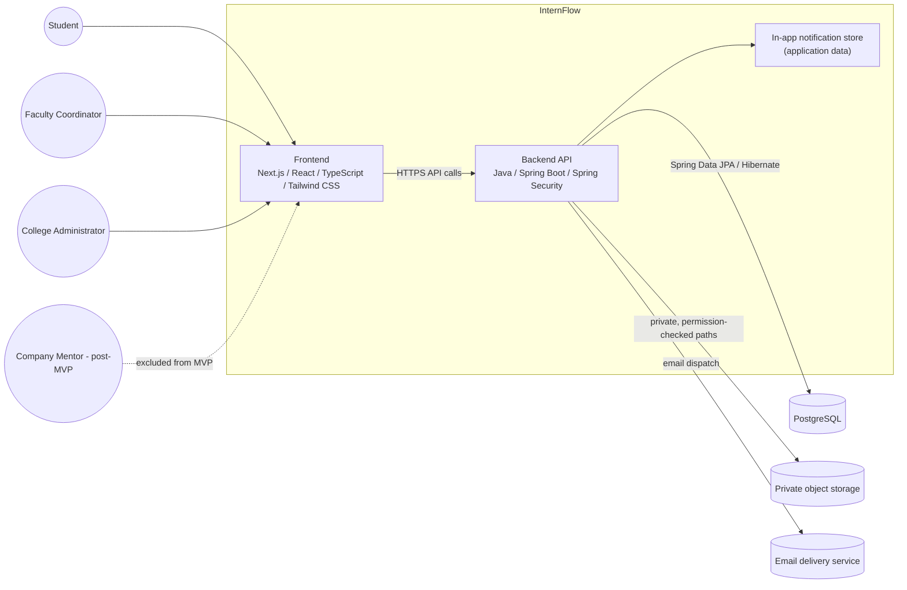
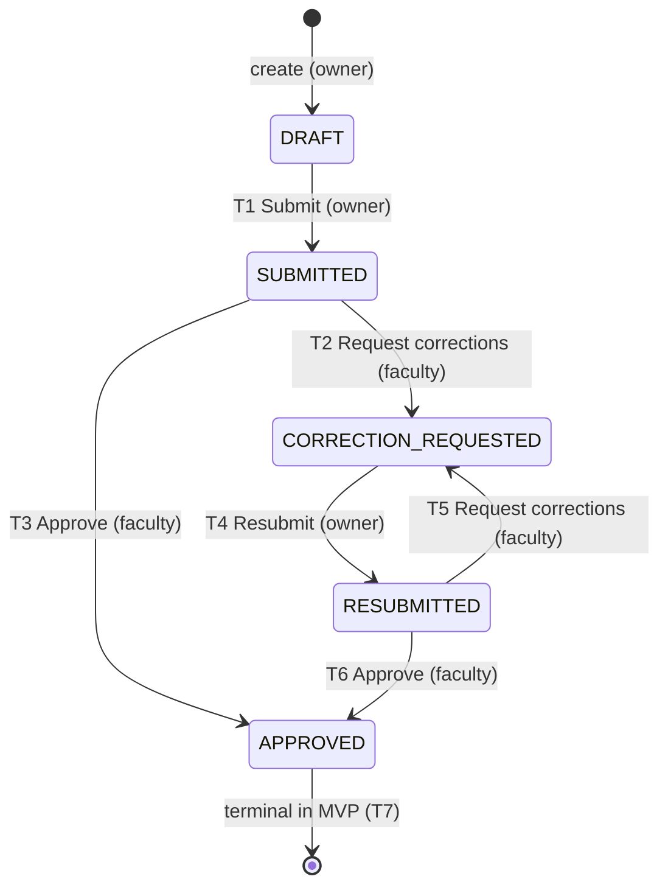
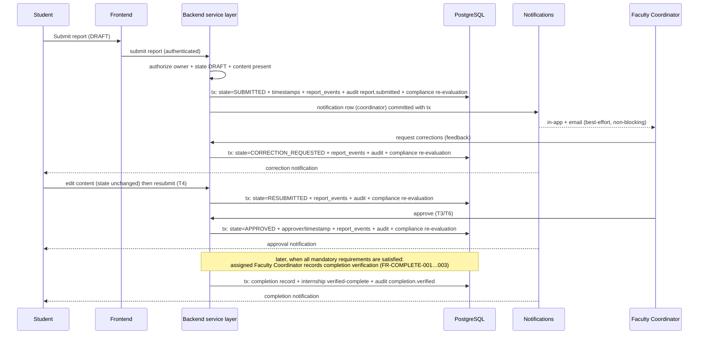

# InternFlow System Architecture Document (SAD)

**Project:** InternFlow

## 1. Document Control

| Field | Value |
|---|---|
| Document Title | InternFlow System Architecture Document (SAD) |
| Project Name | InternFlow |
| Document Identifier | IF-DOC-SAD-001 |
| Version | 1.0 |
| Status | Draft — Pending Review (not approved) |
| Last Updated | 2026-10-15 |
| Purpose | Translate the approved-for-review requirements baseline (PRD, FRD, SRS) into an implementation-oriented technical design: architecture style, module boundaries, backend layering, frontend structure, authorization architecture, key workflows, API and integration boundaries, transaction and storage design, deployment and testing approach, and the open architecture decisions that remain. This document guides later implementation stages; it does not implement anything. |
| Related Source Documents | PRD v1.0 — `docs/requirements/PRD.md` (baseline commit `9f91303`); FRD v1.0 — `docs/requirements/FRD.md` (commit `c8b8754`); SRS v1.0 — `docs/requirements/SRS.md` (commit `7ffeecc`); README — `README.md`. Companion deliverables: `docs/architecture/DDD.md` (Database Design Document), `docs/architecture/DECISIONS.md` (Technology and Architecture Decisions Record). |
| Intended Audience | Project reviewer/stakeholder; the development team implementing the MVP; authors of the API Specification, Security Requirements, UI/UX Specification, Test Plan, and Deployment and Operations Guide. |

**Review note:** This document is a draft pending human review and must not be treated as approved. It resolves no open decision. It does not modify the PRD, FRD, or SRS, and where those documents leave a matter open, this document records the gap rather than inventing a rule.

**Status conventions** (consistent with FRD §2.4 and SRS §2.6): every architectural statement below carries one of **Confirmed** (established by PRD/FRD/SRS, source cited), **Derived** (follows necessarily from an established decision; flagged for review), **Proposed** (offered by this document because some design must exist; requires review before being treated as decided), **Open decision (OD-xx)** (genuinely unresolved in FRD §9, carried forward unchanged), or **Assumption (AS-xx)** (FRD §9.3; not approved). Architecture-specific suggestions are additionally labeled **Recommendation** and are never presented as confirmed.

## Table of Contents

- [1. Document Control](#1-document-control)
- [2. Architectural Goals and Principles](#2-architectural-goals-and-principles)
- [3. System Context and Scope](#3-system-context-and-scope)
- [4. Architecture Style](#4-architecture-style)
- [5. Logical Architecture](#5-logical-architecture)
- [6. Backend Layering and Responsibilities](#6-backend-layering-and-responsibilities)
- [7. Frontend Architecture](#7-frontend-architecture)
- [8. Authentication and Authorization Architecture](#8-authentication-and-authorization-architecture)
- [9. Key Workflows and Component Interactions](#9-key-workflows-and-component-interactions)
- [10. API and Integration Architecture](#10-api-and-integration-architecture)
- [11. Database and Transaction Boundaries](#11-database-and-transaction-boundaries)
- [12. File Storage Architecture](#12-file-storage-architecture)
- [13. Notification Architecture](#13-notification-architecture)
- [14. Auditability and Observability](#14-auditability-and-observability)
- [15. Deployment Architecture](#15-deployment-architecture)
- [16. Testing Architecture](#16-testing-architecture)
- [17. Architecture Risks and Open Decisions](#17-architecture-risks-and-open-decisions)
- [18. Traceability](#18-traceability)

## 2. Architectural Goals and Principles

The architecture is derived from the PRD goals and non-functional expectations (PRD §5, §12), the FRD permission and workflow rules (FRD §4, §5), and the SRS system-level and quality requirements (SRS §6.3, §7). The principles below are the criteria against which later design choices should be judged.

| # | Goal / principle | What it means for this system | Source |
|---|---|---|---|
| P1 | **Maintainability** | A modular monolith with clear module boundaries, consistent layering, and one place per business rule. No module's internals are reachable except through its service surface. Quantitative code-quality targets remain open. | PRD §12 (maintainability), §14.1; NFR-MNT-001…003 |
| P2 | **Security** | Deny-by-default, server-side authorization on every protected operation; private file storage with no public URLs; secrets externalized; generic authentication failures; no sensitive data in logs. Interface hiding is never an enforcement mechanism. | FR-AUTH-003/004/007; NFR-SEC-001…010; SRS-AUTH-001…008 |
| P3 | **Clear separation of responsibilities** | Frontend presents and collects; backend authorizes, validates, transitions state, and persists; PostgreSQL enforces structure; object storage holds only file content; email delivery is an external service. | SRS §5.2; NFR-MNT-002 |
| P4 | **Data integrity** | Referential integrity across all entities; atomic workflow transitions; no partial writes on failure; one report per internship-period enforced at persistence; no deletion of internships, reports, documents, or cohorts in the MVP. | FR-INT-008, FR-REPORT-006; NFR-DAT-001…009 |
| P5 | **Auditability** | Required audit events are written in the same transaction as the action they describe; audit records are append-only through application workflows; attribution survives deactivation. | FR-AUDIT-001…005; NFR-REL-002; NFR-AUD-001…004 |
| P6 | **Testability** | Business rules live in plain, invocable service/domain components so that unit, integration, authorization, workflow, and end-to-end tests can target the invariants that matter (role boundaries, state transitions, compliance, completion). | PRD §13.1; SRS §12; NFR-MNT-004 |
| P7 | **Appropriate scalability for the initial deployment** | The system targets one college department or internship cohort. Design for that load: a single backend instance is acceptable; no distributed infrastructure, caching tier, or message broker is introduced without a demonstrated requirement. | PRD §11.1, §14.1; SRS §3.4 |
| P8 | **Reliable workflow enforcement** | The report state machine (five states, transitions T1–T10) exists once, server-side, and is the only path to a state change. Compliance and completion consume recorded state; they never infer from the UI. | FRD §5; SRS-FR-003; SRS-WF-001…007 |
| P9 | **Simplicity for a single-college deployment** | Two deployables (frontend, backend) plus PostgreSQL, private object storage, and an email service. Avoid enterprise patterns (broker, CQRS, event sourcing, microservices) that the requirements do not demand. | PRD §5.2 (non-goal: microservices); §11.2 |
| P10 | **No invented policies** | Where PRD/FRD/SRS leave a value open (deadlines, retention, file limits, token lifetimes, compliance vocabulary), the design records the option and cites the open decision instead of hard-coding an invented value. | PRD §18; FRD §2.4; SRS §3.5, §14.3 |

## 3. System Context and Scope

### 3.1 Human actors

| Actor | MVP status | Role summary | Source |
|---|---|---|---|
| Student | MVP | Registers internship details; submits documents; creates, edits, submits, resubmits weekly reports; reviews own compliance, deadlines, notifications, completion status. Acts only on own records. | PRD §6.1; FRD §3.1 |
| Faculty Coordinator | MVP | Reviews internship details, documents, and weekly reports of assigned cohorts; requests corrections; **sole approver of weekly reports**; monitors compliance; verifies completion when eligible. Cohort-scoped authority. | PRD §6.2, §11.1; FRD §3.2 |
| College Administrator | MVP | User and role administration; cohort management; requirement and deadline configuration; monitoring and reporting. **Administrative status alone never grants review, approval, or completion-verification authority.** | PRD §6.3; FRD §3.3, §4.4 (PR-05); SRS-WF-025 |
| Company Mentor | Post-MVP (excluded) | No permissions, screens, or requirements in the MVP. | PRD §6.4; FRD §3; SRS-FR-002 |

### 3.2 System components and external services



The diagram shows responsibilities, not deployment topology or vendor selection (consistent with SRS §4.1).

| Component | Responsibility inside the boundary | Source |
|---|---|---|
| Frontend (Next.js) | Role-specific interfaces; presentation and input collection; authentication state display; API communication. Never the authority for any business rule. | PRD §11.2; SRS §5.1 |
| Backend API (Spring Boot) | Authentication, authorization, validation, workflow transitions, compliance evaluation, audit recording, notification generation, report/export generation, storage mediation. | PRD §11.2; SRS §4.2 |
| PostgreSQL | Structured persistence, referential integrity, uniqueness and check constraints, transaction semantics. | PRD §11.2; SRS §4.4 |
| Private object storage | Binary content of submitted documents only; never publicly addressable. | PRD §11.2; FR-DOC-007 |
| Email delivery service (external) | Delivers notification emails composed by the backend. Delivery is best-effort and non-blocking. | PRD §11.2, §14.2; FR-NOTIF-005/006 |
| In-app notification store (application data) | Per-user notification rows and read status, private to the recipient. | FR-NOTIF-004/007; SRS §4.4 |

### 3.3 Deployment and integration boundaries

- **External services:** PostgreSQL, private object storage, email delivery service, frontend hosting (Vercel), backend hosting (to be selected). See SAD §15 and `DECISIONS.md`.
- **No MVP integration boundary** exists to college systems (LMS/SIS), job portals, or other external identity providers unless OD-15 later selects an external identity mechanism.
- **In scope (MVP):** all 13 essential modules of PRD §7.1, the report lifecycle of FRD §5, and the first major milestone of PRD §9.
- **Out of scope (post-MVP, not designed here):** Company Mentor evaluations, attendance tracking, advanced analytics and PDF reports, additional notification channels, multi-department/multi-college support, external college-system integrations (PRD §7.2, §16; SRS §4.3; SRS-FR-002). These are explicitly not promoted into any MVP design element below.

## 4. Architecture Style

**Decision: modular monolith (Confirmed).** The backend is a single deployable Java/Spring Boot application organized into modules with defined responsibilities and boundaries; the frontend is a separate Next.js application; both are backed by PostgreSQL, private object storage, and an email service (PRD §5.2, §11.2, §14.1; NFR-MNT-001).

**Why this is appropriate here:**

- The PRD explicitly lists "a microservices-based system" as a non-goal (PRD §5.2) and records the modular monolith as an established technical decision (PRD §11.2).
- The deployment scope is one department or cohort (PRD §11.1). A single transactional backend gives straightforward consistency for workflow transitions, compliance recalculation, and audit writes (SRS-IF-09, NFR-REL-002), which a distributed design would complicate without benefit.
- The 12-week timeline and single-team development context favor one codebase, one deployment pipeline, and one database (PRD §14.1).
- Cross-module operations (report approval → review history → audit event → compliance recalculation → notification) are naturally atomic inside one process and one transaction.

**Component responsibilities:**

| Component | Responsibilities | Explicitly not responsible for |
|---|---|---|
| Frontend | Render role-appropriate views; collect and locally validate input for usability; maintain auth state for navigation; call the backend API; display loading/empty/error states. | Authorizing anything; deciding state transitions; computing compliance; enforcing any business rule (FR-AUTH-004, SRS-UI-06). |
| Backend API | Authenticate; authorize (role + scope); validate input; execute workflow transitions; evaluate compliance; write audit events; generate notifications; produce reports/CSV; mediate storage access. | Serving static document content publicly; direct email transport reliability guarantees (OD-09). |
| Persistence layer (Spring Data JPA / Hibernate) | Map domain objects; enforce referential integrity, uniqueness, and check constraints; provide transaction semantics. | Holding business logic that belongs to the service layer (validation of state machines remains server-side in the service/domain layer, backed by constraints where feasible — SAD §11). |
| Supporting infrastructure | PostgreSQL (data), object storage (file content), email service (delivery), Vercel (frontend hosting), backend host (to be selected). | Any workflow decision. |

Microservices are not proposed anywhere in this document. Reopening that decision would require an explicit PRD change (PRD §5.2, §14.1).

## 5. Logical Architecture

The 13 essential MVP modules are all represented below, whether scheduled for early or late implementation (PRD §7.3). For each module: primary responsibility, data it owns or manages, interactions, authorization/business-rule boundaries, and source requirements.

> **Note on implementation structure:** the repository currently contains documentation only (`README.md` and `docs/requirements/`). The package boundaries in §5.14 are **recommendations for a future implementation**, not a description of existing code.

### 5.1 Module 1 — Authentication and Authorization

- **Primary responsibility:** Verify identity at sign-in, maintain the authenticated state until sign-out/expiry, and enforce role-based and record-scope authorization on every protected operation server-side.
- **Data it owns or manages:** Credential and account-status data on the user record (mechanics open — OD-15); authenticated principal derived per request. No separate identity store in the MVP design.
- **Important interactions:** Consumes user/role/status data (Module 2); protects every other module's operations; produces generic authentication-failure outcomes (FR-AUTH-001/005/006) and uniform authorization failures (FR-AUTH-007).
- **Authorization / business-rule boundaries:** Deny by default (NFR-SEC-002); role checks plus scope checks (own record / assigned cohort / deployment) (FR-AUTH-003, FR-USER-007); enforcement server-side regardless of UI (FR-AUTH-004); deactivated accounts cannot authenticate and lose operation rights on the next protected request (FR-AUTH-005).
- **Related source requirements:** PRD §7.1.1, §10, §15.3; FR-AUTH-001 … FR-AUTH-007; SRS §6.3 (SRS-FR-001), §7.1, §10. Open: OD-15, OD-01.

### 5.2 Module 2 — User Management

- **Primary responsibility:** Create user accounts, assign and change roles (three MVP roles only), edit directory data, deactivate accounts, list/search users within scope; keep user administration separate from internship-specific scope assignment.
- **Data it owns or manages:** `users` (identity, display name, role, account status, activation status); role-change and status-change history via audit events.
- **Important interactions:** Supplies role/scope inputs to Module 1; cohort membership and coordinator assignment (Module 4) provide record scope for faculty (FR-USER-007); audit events recorded for `user.created`, `user.role_changed`, `user.deactivated`.
- **Authorization / business-rule boundaries:** Administrator-only creation/role assignment (FR-USER-001/002); self-role-change and self-deactivation unsettled (OD-01); no account deletion in the MVP — deactivation preserves all records and attribution (FR-USER-005, PR-08, SRS-FR-009); duplicate identity rejected (FR-USER-006); no self-registration (AS-05).
- **Related source requirements:** PRD §6.3, §7.1.2; FR-USER-001 … FR-USER-008; SRS §6.2, §10. Open: OD-01, OD-15; Proposed: PR-04, PR-06.

### 5.3 Module 3 — Internship Management

- **Primary responsibility:** Register and maintain internship records (student, cohort, dates, descriptive details), track lifecycle state at the two established anchors (registered; verified complete), and keep relationships resolvable for compliance.
- **Data it owns or manages:** `internships` (student, cohort, start/end dates, descriptive details, lifecycle state).
- **Important interactions:** Created by the student (FR-INT-001); parent of reports (Module 6) and documents (Module 5); resolves the requirement set through internship → cohort (Module 4) for compliance (Module 8); edit events affecting evaluation trigger recalculation (FR-COMP-007); completion state set by Module 11.
- **Authorization / business-rule boundaries:** Student may create/edit only own record while not verified complete (FR-INT-007); one active internship per student (**AS-01**); date validation (FR-INT-003); no deletion (PR-08); no reassignment path until OD-13; full lifecycle state set is OD-12 — no intermediate states may be invented (FR-INT-004).
- **Related source requirements:** PRD §7.1.3, §8 step 2; FR-INT-001 … FR-INT-008; SRS §8 (SRS-DR-002, SRS-DR-004). Open: OD-12, OD-13.

### 5.4 Module 4 — Cohort Management

- **Primary responsibility:** Configure cohorts (identity, period, deadlines), assign students to cohorts, assign Faculty Coordinators to cohorts, and define each cohort's internship requirement set (mandatory/optional) that feeds compliance and completion.
- **Data it owns or manages:** `cohorts`; student–cohort membership; `cohort_coordinator_assignments`; `cohort_requirements`; deadline configuration values (values unsettled — OD-10).
- **Important interactions:** Defines the scope chain for faculty access (Module 1/7) and student scope (Module 2/3); supplies requirement sets to compliance (Module 8); requirement/document-category definitions drive document requirements (Module 5); configuration changes recorded in audit and handled for propagation per OD-03.
- **Authorization / business-rule boundaries:** Administrator-only creation/update/assignment (FR-COHORT-001/002/003); one cohort membership per student at a time (**AS-02**); coordinator cardinality follows **AS-03** (one primary coordinator, additional assignments as permitted extension) with open questions recorded; requirement configuration is an administrator responsibility but scope/change propagation is **OD-03**; membership moves are **OD-14**; no cohort deletion (PR-08).
- **Related source requirements:** PRD §6.3, §7.1.4, §8 step 1; FR-COHORT-001 … FR-COHORT-007; SRS §8, §9.2. Open: OD-03, OD-10, OD-14.

### 5.5 Module 5 — Document Management

- **Primary responsibility:** Support configurable required-document categories per cohort, accept student submissions into private object storage with metadata, expose per-document status, and allow assigned faculty to record document review actions.
- **Data it owns or manages:** `documents` metadata (category/requirement link, internship, uploader, filename, size, media type, storage reference, timestamps, review fields); file content lives only in private object storage.
- **Important interactions:** Categories derive from cohort requirements (Module 4); submissions trigger compliance re-evaluation (Module 8, FR-DOC-008) and notifications to the assigned coordinator (Module 10); review actions are recorded with actor and timestamp (FR-DOC-005); storage mediation per SAD §12.
- **Authorization / business-rule boundaries:** Student uploads only for own internship (FR-DOC-002); retrieval is permission-checked with no public URLs (FR-DOC-007); administrators' access to sensitive document content is unsettled (**OD-01**); file type/size validation is configurable policy (**OD-16**, no values invented); document review outcome set and its compliance effect are **OD-05** — under the interim rule, submission alone advances the requirement; no deletion (PR-08); post-review replacement refused under the interim rule (FR-DOC-004).
- **Related source requirements:** PRD §7.1.5, §8 steps 3–4, §11.2; FR-DOC-001 … FR-DOC-008; SRS §5.2, §7.1. Open: OD-05, OD-16, OD-01.

### 5.6 Module 6 — Weekly Reports and Work Logs

- **Primary responsibility:** Manage the weekly report lifecycle — draft creation, editing rules, submission, resubmission — and hold the work-log content that is prioritized over attendance.
- **Data it owns or manages:** `weekly_reports` (internship, reporting period, state, content, submission/resubmission/approval timestamps); state values are exactly `DRAFT`, `SUBMITTED`, `CORRECTION_REQUESTED`, `RESUBMITTED`, `APPROVED`.
- **Important interactions:** State changes drive compliance (Module 8, FR-REPORT-010) and notifications (Module 10); review actions are performed by Module 7 and recorded in report history; every transition writes an audit event; reports are read by dashboards and exports (Modules 9, 13).
- **Authorization / business-rule boundaries:** Only the owner may create/edit/submit/resubmit (FR-REPORT-001/003/004/008/009); editing permitted only in `DRAFT` and `CORRECTION_REQUESTED`; editing is a permission, never a transition (FRD §5.3); one report per internship per reporting period, enforced atomically (FR-REPORT-006, SRS-DR-010); reporting-period cadence and late-submission policy are **OD-10** (interim: timestamps recorded, no lateness enforcement — FR-REPORT-005); post-approval modification/reopening is **OD-02** (`APPROVED` terminal); no cycle cap (**AS-06**).
- **Related source requirements:** PRD §7.1.6, §8 steps 5/7, §9; FR-REPORT-001 … FR-REPORT-010; FRD §5; SRS §9.1. Open: OD-02, OD-10.

### 5.7 Module 7 — Faculty Review Workflow

- **Primary responsibility:** Present scoped review queues, execute the two review actions (request corrections, approve) with mandatory attribution, and maintain append-only review history.
- **Data it owns or manages:** Review queue queries over `weekly_reports`; `report_events` review history (action type, actor, timestamp, feedback); approval attribution (approver, timestamp).
- **Important interactions:** Consumes Module 6 state; writes history + audit atomically with each transition (FR-REVIEW-002, SRS-IF-09); triggers notifications (Module 10) and compliance recalculation (Module 8); feeds dashboard pending-review views (Module 9).
- **Authorization / business-rule boundaries:** **Faculty Coordinators alone approve weekly reports** (PRD §11.1; FR-REVIEW-004); students and administrators are denied review actions (FR-REVIEW-008; PR-05); access limited to assigned cohorts (FR-REVIEW-001; PR-01 proposed); reviewers never edit student report content (PR-02); only `SUBMITTED`/`RESUBMITTED` are reviewable; `APPROVED` actions refused (FR-REVIEW-010); no review-deadline blocking under the interim rule (**OD-10**).
- **Related source requirements:** PRD §6.2, §7.1.7, §9, §11.1; FR-REVIEW-001 … FR-REVIEW-010; SRS §9.1, §10.2. Open: OD-02, OD-10; Proposed: PR-01, PR-02, PR-03.

### 5.8 Module 8 — Compliance Engine

- **Primary responsibility:** Resolve each internship's applicable requirement set (student → internship → cohort → requirement set), evaluate each requirement's satisfaction, and produce the single compliance result used by every surface.
- **Data it owns or manages:** Persisted evaluation results (`requirement_evaluations`, per DDD) — derived data only; compliance status vocabulary is proposed and unsettled (**OD-04**); no percentage/weighting exists (FR-COMP-002, SRS-WF-016).
- **Important interactions:** Reads reports (state-based rules FR-COMP-003/004/006, FR-REPORT-010), documents (FR-COMP-005), and requirement definitions (Module 4); triggered by workflow events (FR-COMP-007); consumed by dashboards (Module 9), completion eligibility (Module 11), reports/exports (Module 13); configuration gaps surfaced explicitly (`CONFIGURATION_MISSING`-style outcome, never "compliant") (FR-COMP-001, FR-COMP-010).
- **Authorization / business-rule boundaries:** Status is computed and never edited by any role (**PR-07**); manual recalculation trigger is an open decision (**OD-04** interim: only event-driven recalculation is required); requirement-change propagation is **OD-03** (no hardcoded grandfather/retroactive behavior); evaluation failure marks results stale/unevaluated, never satisfied (FR-COMP-007, NFR-REL-005).
- **Related source requirements:** PRD §7.1.8, §9, §11.1; FR-COMP-001 … FR-COMP-010; SRS §9.2. Open: OD-03, OD-04, OD-05.

### 5.9 Module 9 — Role-Specific Dashboards

- **Primary responsibility:** Present role-appropriate status and pending actions: student (own internship, report states, documents, compliance, deadlines, pending actions, completion progress), faculty (assigned students, review queue, outstanding corrections, cohort compliance overview), administrator (deployment-wide operational overview, administrative entry points, no review/approval actions).
- **Data it owns or manages:** No owned data — read-only aggregation over other modules' data plus the single compliance source (FR-DASH-006, SRS-FR-004).
- **Important interactions:** Queries Modules 3, 5, 6, 7, 8, 10, 11; presents actions whose authorization is enforced independently by the target module (FR-DASH-007).
- **Authorization / business-rule boundaries:** Scope enforced at data retrieval, not display (FR-DASH-005, SRS-FR-007); students see own records only; faculty see assigned cohorts; administrator sees deployment scope; the administrator dashboard offers no review/approval actions (FR-DASH-004, PR-05); deadline panels show "not configured" rather than invented dates (FR-DASH-002).
- **Related source requirements:** PRD §7.1.9; FR-DASH-001 … FR-DASH-007; SRS §5.1, §6.2. Open: OD-01, OD-10.

### 5.10 Module 10 — Notifications and Deadlines

- **Primary responsibility:** Generate one notification per event occurrence per recipient for confirmed workflow events, store in-app notifications with read status, and dispatch email copies through the configured service.
- **Data it owns or manages:** `notifications` rows (recipient, event type, record reference, timestamp, message, read status, email delivery status).
- **Important interactions:** Triggered by Modules 5, 6, 7, 11 (submission, correction, resubmission, approval, document submitted, completion verified) and by deadline configuration where it exists; recipients resolved from record relationships, never user input (FR-NOTIF-002, SRS-FR-006).
- **Authorization / business-rule boundaries:** Notification lists are private to the recipient (FR-NOTIF-004); no sensitive document content embedded (FR-NOTIF-003, NFR-PRV-003); delivery is non-blocking and must never roll back the business action (FR-NOTIF-006, NFR-REL-004); duplicate prevention per occurrence (FR-NOTIF-007); trigger list beyond the confirmed set, timing, and retries are **OD-09**; deadline semantics **OD-10**; retention **OD-11**.
- **Related source requirements:** PRD §7.1.10, §11.2; FR-NOTIF-001 … FR-NOTIF-007; SRS §5.2, §7.3. Open: OD-09, OD-10, OD-11.

### 5.11 Module 11 — Completion Verification

- **Primary responsibility:** Compute completion eligibility from compliance results, and record verification (verifier, timestamp, evaluated requirement results) only when every mandatory requirement is satisfied and the actor is authorized.
- **Data it owns or manages:** `completion_verifications` record (one per internship) and the internship's verified-complete state; verification history is append-only (FR-COMPLETE-008).
- **Important interactions:** Consumes Module 8 evaluation output (FR-COMPLETE-001); sets internship lifecycle anchor (Module 3); triggers student notification (Module 10) and audit event `completion.verified` (Module 12); locks further workflow modifications to reports/documents/internship (FR-COMPLETE-003/005).
- **Authorization / business-rule boundaries:** Only a Faculty Coordinator assigned to the internship's cohort may verify (FR-COMPLETE-002, PRD §8 step 9); **College Administrators do not automatically receive completion-verification authority — that remains OD-08**; students always denied; ineligible attempts rejected with the outstanding-requirement list (FR-COMPLETE-004); verified completion is immutable in the MVP (FR-COMPLETE-005, SRS-WF-022); progress display never equals verified completion (FR-COMPLETE-006).
- **Related source requirements:** PRD §7.1.11, §8 step 9, §11.1, §15.1; FR-COMPLETE-001 … FR-COMPLETE-008; SRS §9.3. Open: OD-08, OD-03.

### 5.12 Module 12 — Audit History

- **Primary responsibility:** Record the required set of important actions atomically with the action, protect events from modification or deletion, and expose them to authorized users within their scope.
- **Data it owns or manages:** `audit_events` (event type, actor or "system", entity type/id, timestamp, before/after values where applicable).
- **Important interactions:** Written by Modules 2, 3, 4, 5, 6, 7, 11 (and possibly 13 for exports); persistence failure fails the originating action for the required set (FR-AUDIT-001, NFR-REL-002); consumed by authorized views.
- **Authorization / business-rule boundaries:** No application path edits or deletes events, for any role (FR-AUDIT-005; explicit admin denial is a strengthening marked Proposed); viewing mapping is **OD-06** (proposal: administrator deployment-wide, faculty assigned-cohort, students denied); retention is **OD-11** — no retention duration is asserted anywhere; the required event set is confirmed, the extended set is proposed under **OD-06**.
- **Related source requirements:** PRD §7.1.12; FR-AUDIT-001 … FR-AUDIT-006; SRS §7.8. Open: OD-06, OD-11.

### 5.13 Module 13 — Reports and CSV Exports

- **Primary responsibility:** Provide basic operational reports (proposed RPT-01 … RPT-03, pending **OD-07**) and CSV exports whose rows never exceed the requesting user's permitted scope.
- **Data it owns or manages:** No owned persistent data — queries over internships, reports, documents, and the single compliance source; generated CSV files are streamed, not stored (unless later decided).
- **Important interactions:** Reads Modules 3, 4, 6, 8; must show figures identical to dashboards (FR-DASH-006); CSV generation includes formula-injection neutralization (FR-EXPORT-004, NFR-SEC-006); export audit events only if **OD-06** adopts them.
- **Authorization / business-rule boundaries:** Administrator deployment-wide; faculty assigned-cohort only; student access is **OD-07**; out-of-scope rows excluded or refused per documented policy (FR-EXPORT-003, SRS-FR-007); invalid filters rejected (FR-EXPORT-005); empty results are header-only success (FR-EXPORT-006, proposed); failures produce no partial file (FR-EXPORT-007).
- **Related source requirements:** PRD §7.1.13, §10, §15.3; FR-EXPORT-001 … FR-EXPORT-008; SRS §5.2, §7.7. Open: OD-07, OD-06, OD-01.

### 5.14 Recommended package boundaries (recommendation, not existing code)

A conventional Spring Boot modular layout is **recommended** for later implementation; nothing below exists yet, and the layout may be adjusted at Stage 1.5:

```
com.internflow
  auth/            # Module 1  - security configuration, principal, authorization services
  users/           # Module 2
  internships/     # Module 3
  cohorts/         # Module 4 (incl. membership, coordinator assignment, requirements)
  documents/       # Module 5
  reports/         # Module 6 (report lifecycle)
  review/          # Module 7 (review actions, review history)  - may live inside reports/ if preferred
  compliance/      # Module 8
  dashboards/      # Module 9 (read models / queries)
  notifications/   # Module 10
  completion/      # Module 11
  audit/           # Module 12
  exports/         # Module 13
  shared/          # cross-cutting: error taxonomy mapping, pagination, clock, identifiers
```

Each module exposes a service surface used by controllers and by other modules; module internals (entities, repositories) are not accessed directly across modules. This is a **Recommendation/Proposed** structure; whether Module 7 is merged into Module 6 is an implementation detail for Stage 1.5.

## 6. Backend Layering and Responsibilities

A three-layer core (controller → service → repository) with cross-cutting concerns is sufficient. Deeper layering (separate domain/application/infrastructure projects, ports-and-adapters) is deliberately avoided without justification (**P9**, SRS §7.5).

| Layer / concern | Responsibility | Notes and justification |
|---|---|---|
| Controllers and API endpoints | Translate HTTP requests into service calls; enforce authentication at the perimeter; map service outcomes to responses. | Controllers contain no business rules; they resolve the authenticated principal and delegate. Endpoint catalogue belongs to the future API Specification. |
| Request/response DTOs | Isolate the wire contract from persistence entities; carry validation annotations for input shape. | Prevents entity leakage and accidental over-posting; server-side validation remains authoritative (SRS-IF-03, NFR-SEC-005). |
| Application/service layer | The single home for use-case orchestration: authorization call, validation, state transition, side-effect coordination (history, audit, compliance, notification) within one transaction. | This is where FRD §5 transitions and FRD §4 permission cells are implemented; matches SRS-AUTH-001 (authorization before business logic). |
| Domain rules and workflow transitions | Report state machine (five states, T1–T10), editability rules, completion eligibility, compliance evaluation rules, requirement classification. | Kept in plain classes/methods so JUnit unit tests can target them directly (SAD §16). State changes are accepted only through defined transitions (SRS-FR-003). |
| Repositories and persistence | Spring Data JPA repositories; transaction boundaries via Spring's transaction management; constraint enforcement delegated to PostgreSQL where feasible (unique report per period — SRS-IF-08). | No business logic in repositories; no cascade deletions (PR-08, SRS-DR-012). |
| Authentication and authorization | Spring Security authenticates requests; an authorization service evaluates role + record scope (own / assigned cohort / deployment) for each protected operation. | Session/token mechanics are **OD-15** and not fixed here (SAD §8). |
| Validation and exception handling | Bean validation for input shape; service-layer business validation; a single exception-handling boundary mapping internal outcomes to the five FRD §7.1 failure categories (business validation, authorization, invalid transition, technical, configuration-missing). | Categories are functional, not wire formats; concrete codes/shapes belong to the API Specification (SRS-ERR-002, SRS-IF-04). Error text must not assert open policies (SRS-ERR-014). |
| Notification delivery | Service records notification rows in the business transaction; email dispatch occurs without blocking the business outcome (post-commit, best-effort), with failures recorded. | Non-blocking is confirmed (FR-NOTIF-006); the dispatch mechanism is **Proposed** and retry/scheduling policy is **OD-09** (SAD §13). |
| Audit event recording | Written in the same transaction as the triggering action for the required event set; failure fails the action. | Confirmed: FR-AUDIT-001, FR-REVIEW-002, SRS-IF-09, NFR-REL-002. |
| File-storage integration | A storage gateway behind the document module: authorize → validate → write/read private object storage → persist metadata. | No storage SDK types leak into controllers or entities (SAD §12). |

**Server-side enforcement (Confirmed):** the frontend is never trusted. All permission cells in FRD §4, all state transitions in FRD §5.2, all validation rules, and all scope filters are enforced in the backend before persistence; the client may only request operations (FR-AUTH-003/004, NFR-SEC-001, SRS-FR-001, SRS-FR-003, SRS-FR-007). Hiding a button is usability, not security (SRS-UI-06).

## 7. Frontend Architecture

**Scope note:** this section defines structural responsibilities only. No page designs, layouts, or UI components are specified here — that belongs to the future UI/UX Specification (out of scope for this substage).

- **Application structure (Proposed):** a Next.js (App Router) TypeScript application with route groups per role — student, faculty coordinator, college administrator — plus a shared unauthenticated area (sign-in). Shared UI components (tables, status badges, forms, empty/error panels) live in a common component library used by all role areas.
- **Role-specific interfaces:** each role area renders only the workflows its role is permitted to use (SRS-UI-02, SRS-UI-03). The server remains the enforcement authority: directly requesting a restricted route must still fail at the backend (FR-AUTH-004, SRS-UI-06).
- **Authentication state and protected routes:** the frontend maintains session/auth state for navigation and conditional rendering; a client-side route guard redirects unauthenticated users for usability. This is explicitly **not** the enforcement mechanism (SRS-AUTH-005). Session/token mechanics remain **OD-15**.
- **API communication:** a single typed API client layer (fetch wrapper) owns base URL configuration, credentials, error handling, and mapping of backend failure categories to user-visible messages. Components never call `fetch` directly. This layer is where a future API version prefix would be applied (SAD §10).
- **Form validation:** client-side validation for immediate feedback (required fields, date order, file type/size hints) — purely advisory; identical rules are enforced server-side, and server responses are authoritative (NFR-SEC-005, SRS-IF-03).
- **Loading, empty, success, and error states:** every data view defines all four states explicitly. Configuration gaps (no requirement set, no deadline configured) render as explicit "not configured" states, never as default-compliant or invented values (FR-DASH-002, FR-COMP-001, SRS-ERR-009).
- **Dashboard responsibilities:** dashboards fetch role-scoped aggregates from the backend and present pending actions as links to permitted operations; they perform no compliance computation and no scope filtering of their own beyond display (FR-DASH-005, FR-DASH-006, FR-DASH-007).
- **Separation of presentation and business logic:** report-state meaning, compliance interpretation, and permission decisions are never re-implemented in the frontend; the frontend renders states and reasons returned by the backend. Business logic exists once, server-side (**P3**, NFR-MNT-002).

## 8. Authentication and Authorization Architecture

### 8.1 Spring Security responsibilities

Spring Security (Confirmed — PRD §11.2) is responsible for:

1. **Authentication:** verifying credentials at sign-in, establishing and terminating the authenticated state, applying the generic failure message that does not reveal account existence or activation status (FR-AUTH-001, FR-AUTH-005, FR-AUTH-006, NFR-SEC-003).
2. **Role-based authorization:** restricting operations to Student, Faculty Coordinator, or College Administrator as the FRD §4 matrix specifies (FR-AUTH-003).
3. **Resource-level authorization:** restricting each operation to records in the requester's scope — own records (Student), assigned cohorts (Faculty Coordinator), deployment scope (College Administrator) — evaluated per request (FR-AUTH-003, FR-USER-007, SRS-AUTH-002).

The three MVP roles are preserved exactly; the Company Mentor has no MVP permissions and is post-MVP (PRD §6.4; FRD §3; SRS §3.3). Each user holds a single role in the MVP (**AS-04**).

### 8.2 Three distinct layers (must not be conflated)

| Layer | Question answered | Example | Where enforced |
|---|---|---|---|
| Authentication | Who is calling? | Sign-in with valid credentials | Spring Security filter chain |
| Role-based authorization | Is this role allowed to attempt this operation at all? | Only Faculty Coordinators may call "approve report" | Method/route-level rules |
| Resource-level authorization | Is this specific record within the caller's scope? | Approver must be the assigned coordinator for the report owner's cohort; a student may only touch own records | Service layer, per record, before any business logic (SRS-AUTH-001) |

A role alone never grants record-level authority (FR-USER-007, SRS-AUTH-002): a Faculty Coordinator with no assigned cohort can review nothing; an Administrator with no cohort assignment cannot approve reports (FR-USER-007 AC2).

### 8.3 Preserved authority boundaries (Confirmed unless noted)

- **Faculty Coordinators alone approve weekly reports** (PRD §11.1; FR-REVIEW-004; SRS-WF-002).
- **College Administrators do not gain weekly-report approval authority** from administrative privileges; review attempts by administrators fail with authorization failure (FR-REVIEW-008 AC1; PR-05 — Proposed prohibition, consistent with PRD §6.3 vs §6.2/§11.1).
- **College Administrators do not automatically receive completion-verification authority**; default behavior refuses administrator verification, and granting it is **OD-08** (FR-COMPLETE-002; SRS-WF-018; SRS-AUTH-010).
- **Users must not access or modify resources belonging to other users or unauthorized cohorts**, including via direct references or parameter manipulation (FR-COHORT-006, FR-DASH-005, FR-EXPORT-003, SRS-AUTH-008; PR-01 scope rule is Proposed pending confirmation).
- **Sensitive operations are authorized by the backend** regardless of UI visibility (FR-AUTH-004, NFR-SEC-001, SRS-UI-06).
- Administrator boundaries still open: access to sensitive student record content, self-role-change, self-deactivation — **OD-01**; audit viewing — **OD-06**.

### 8.4 Session and token strategy — not decided here

The source documents establish Spring Security but **not** the credential/session mechanics (FR-AUTH-002 AC2; OD-15). Available options to be evaluated at Security Requirements (recorded, not chosen):

| Option | Summary | Considerations |
|---|---|---|
| A. Server-side session (cookie) | Spring Security session stored server-side; frontend and API share the auth cookie. | Simple state model; fits a two-deployable design; session store is the backend host. |
| B. Stateless token (e.g., JWT) | Signed token issued at sign-in, validated per request. | No server session state; requires token lifetime/renewal policy (part of OD-15) and careful XSS/CSRF handling. |
| C. External identity provider | Delegated authentication. | Adds an external dependency; only relevant if OD-15 selects it; no MVP requirement does. |

Account provisioning/activation mechanics (administrator-set credentials, invitation, first-login activation) are equally open under **OD-15**; the design only requires that creation is distinct from activation and that unactivated accounts cannot sign in (FR-USER-001, FR-AUTH-001 AC4). No password policy, lockout threshold, or token lifetime is invented in this document (**P10**).

## 9. Key Workflows and Component Interactions

### 9.1 The critical workflow (confirmed requirements)

**Student submits weekly report → Faculty Coordinator reviews → Faculty Coordinator requests corrections or approves → Student resubmits when corrections are requested → Compliance status recalculated → Completion eligibility evaluated against all mandatory requirements → Authorized completion approval recorded.**

The report state model is fixed at five states with the transitions T1–T10 of FRD §5.2. No state or transition beyond those exists in this design (SRS-WF-006; any addition requires **OD-02**).



### 9.2 End-to-end interaction (first major milestone)



### 9.3 Component interactions per event type

| Event | Confirmed behavior (source) | Proposed internal implementation detail |
|---|---|---|
| Report submission / resubmission | Owner-only; state transition with timestamps; review history entry; audit event; coordinator notification; compliance re-evaluation (FR-REPORT-004/008; FR-REVIEW-002; FR-AUDIT-001; FR-COMP-007) | One database transaction covering state + history + audit + compliance rows; notification row written in the same transaction, email dispatched after commit. |
| Faculty review (corrections / approve) | Assigned-cohort faculty only; feedback required for corrections; approver identity + timestamp recorded; audit + notification + compliance effects (FR-REVIEW-003/004) | Optimistic concurrency check on the report row so racing review actions yield exactly one effective transition (NFR-DAT-008, FRD §7.2 case 22) — **Proposed** mechanism, SAD §11. |
| Document submission / review | Permission-checked private upload with metadata; audit `document.submitted`; coordinator notified; faculty records review action with actor/timestamp; compliance effect per **OD-05** interim rule (submission alone advances) (FR-DOC-002/005; FR-COMP-005) | Storage write first, metadata committed in the same transaction; storage failure leaves no document record (FR-DOC-002 AC3). |
| Compliance recalculation | Re-evaluation on every compliance-relevant event; all displays derive from the same evaluation result; failures mark stale, never satisfied (FR-COMP-007, SRS-FR-004, NFR-REL-005) | Synchronous recalculation inside the triggering transaction (scale is one cohort) — **Proposed**; asynchronous alternative explicitly deferred to SRS/implementation if load requires it (FR-COMP-007). |
| Notification generation | One notification per event occurrence per recipient; recipients from record relationships; non-blocking failures (FR-NOTIF-001/002/006/007) | Unique key on (event occurrence, recipient) for duplicate prevention; email send attempted post-commit with failure recorded — retry policy remains **OD-09**. |
| Completion verification | Eligibility from compliance; assigned-cohort faculty only; record with verifier, timestamp, evaluated requirement results; audit + notification; post-verification edits refused (FR-COMPLETE-001…005) | Completion record and internship state written in one transaction with the audit event; eligibility re-checked inside the transaction to close races — **Proposed**. |
| Audit-history recording | Required events written atomically with the action; persistence failure fails the action; append-only; no application-level mutation (FR-AUDIT-001/005; NFR-REL-002) | Single `audit_events` table written through the same transaction manager; database-level write protection (e.g., revoke UPDATE/DELETE) evaluated at Stage 1.5 — **Recommendation**, not decided. |

The left column is **confirmed** by the source documents; the right column is **proposed** internal implementation detail that requires no requirement change and remains subject to review.

## 10. API and Integration Architecture

This section states high-level intentions only. The **API Specification is a separate future deliverable**; no endpoint catalogue, payload schema, or status code is finalized here (SRS-IF-01, SRS-ERR-002).

- **REST API responsibilities (Proposed style, confirmed boundary):** the frontend and backend communicate through a defined API boundary (SRS-IF-01). REST over JSON is the recommended style given the established stack and resource-oriented domain; it is marked **Proposed** in `DECISIONS.md` because the source documents do not fix the protocol style.
- **Request validation:** every mutating operation validates input at the server boundary before persistence and returns business-validation outcomes naming the offending field category (SRS-IF-03, NFR-SEC-005, FRD §7.2).
- **Response DTOs:** responses use purpose-built DTOs, never persistence entities; workflow states are represented so clients cannot bypass the state model (SRS-IF-05).
- **Error response consistency:** all errors map to the five FRD §7.1 categories (business validation, authorization, invalid transition, technical, configuration-missing) so callers can distinguish them (SRS-IF-04). Concrete status codes, error codes, and envelope shape are deferred to the API Specification; authorization failures must not disclose record content or existence (SRS-AUTH-004).
- **Authorization checks:** every protected endpoint enforces authentication, role, and record scope server-side before executing logic (SRS-IF-02, SRS-AUTH-001); scope filters apply to list/filter/sort/pagination parameters (SRS-FR-007).
- **Pagination and filtering:** list endpoints (users, reports, review queue, documents, audit events, exports) require server-side pagination and scope-limited filtering; the exact conventions are part of the API Specification. Exports follow FR-EXPORT-003 row scoping.
- **API versioning considerations:** not established by the source documents. Options (URL prefix versioning vs. header versioning vs. no versioning for a single-frontend MVP) must be decided when the API Specification is written — recorded as an **Open** item in `DECISIONS.md` (IF-DEC-14).
- **Integration boundaries:**
  - **Private object storage:** the backend is the only component with storage credentials; uploads/downloads are permission-checked backend paths; no public URLs (FR-DOC-007, SRS-IF-11). Whether downloads are proxied through the backend or served via short-lived signed URLs created *after* backend authorization is a design option to be fixed in the API Specification (SAD §12).
  - **Email delivery:** the backend composes notifications and hands them to the configured email service through an abstraction; failures are recorded and non-blocking (SRS-IF-13/14). Provider and retry policy remain **OD-09**.

**Contracts that must be specified before implementation (for the future API Specification):** the endpoint catalogue for all 13 modules; authentication endpoints and session/token contract (**OD-15**); pagination/filter conventions; error envelope and status-code mapping; export download contract; document upload/download contract (including signed-URL vs. proxy decision); notification list endpoints; compliance/completion response shapes (pending **OD-04** vocabulary); report catalogue contract (pending **OD-07**).

## 11. Database and Transaction Boundaries

The backend domain modules persist to PostgreSQL through Spring Data JPA and Hibernate (Confirmed — PRD §11.2; SRS-IF-06). Physical design details are in `docs/architecture/DDD.md`; this section states the architectural rules the two documents share.

1. **Referential integrity:** every relationship (student → internship → cohort → requirement set; internship → reports/documents; report → review history; internship → completion) is a real foreign key with no cascade deletion (SRS-IF-07, NFR-DAT-001, SRS-DR-012).
2. **Transactions around workflow transitions:** each state-changing operation (submit, resubmit, request corrections, approve, verify completion, deactivate user, role change, requirement change) executes as one transaction that includes: the state change, its history entry, the required audit event, and the affected compliance re-evaluation (SRS-IF-09, NFR-REL-002, FR-REVIEW-002, FR-AUDIT-001). If audit/history persistence fails, the action fails with no state change (FRD §7.2 case 28).
3. **Consistent compliance calculations:** derived compliance rows are updated in the same transaction as the triggering event (**Proposed** synchronous strategy; scale justifies it) so no surface can show a result contradicting recorded state (FR-COMP-007, NFR-DAT-006, NFR-PERF-004). If evaluation fails, results are marked stale/unevaluated and re-processed — never silently satisfied (NFR-REL-005).
4. **Protection against unauthorized or invalid state transitions:** invalid transitions are rejected by the service layer's state machine; authorization is checked before any logic (SRS-AUTH-001). Database constraints back the invariants that are mechanically checkable — one report per internship-period (unique constraint, atomic — SRS-DR-010), state/role/date check constraints — while role, scope, and eligibility rules necessarily live in the service layer (SAD §11 note below; DDD §10).
5. **Reliable audit recording:** required audit events share the transaction of their action; application workflows expose no update/delete path for audit rows (FR-AUDIT-005, NFR-AUD-004). Additional database-level write protection is a **Recommendation**, not a decided control.
6. **Database constraints for critical invariants:** uniqueness, foreign keys, NOT NULL on critical fields, and check constraints for enumerated values and date ordering (FR-INT-003, FR-REPORT-006). Constraints that cannot be expressed (e.g., "only assigned faculty may approve") remain service-layer rules with dedicated tests (DDD §10).

**Boundary rule:** business logic is not duplicated in the frontend or encoded as database stored logic (triggers/procedures); the service layer is the single home of rules, with the database providing structural guarantees only (**P3**, **P4**; NFR-MNT-002).

## 12. File Storage Architecture

- **Private object storage only:** uploaded document content is stored in private object storage; no publicly accessible or guessable URL exists at any time (FR-DOC-007, NFR-SEC-004, SRS-IF-11). The vendor is **not selected** — "private object storage" is the established decision (PRD §11.2); provider selection is open (`DECISIONS.md` IF-DEC-07, whose provider choice is recorded as an Open item).
- **Authorization before upload and download:** the backend authorizes the requester (owner student; assigned faculty; administrator subject to **OD-01**) *before* any storage operation; unauthorized attempts return access denied without content (FR-DOC-007, SRS-AUTH-004).
- **Metadata/binary separation:** the `documents` table stores metadata only (identity, category/requirement link, internship, uploader, filename, size, media type, storage key, timestamps, review fields); binary content resides solely in object storage (SRS §8.1 "Document" vs "Document content"). Storage keys are opaque identifiers, not user-supplied paths (Proposed).
- **Access control model (Proposed options, decision deferred to API Specification/Security Requirements):** (a) backend-streamed downloads through a permission-checked endpoint; (b) short-lived signed URLs issued only after backend authorization. Both satisfy FR-DOC-007; the choice affects performance and configuration, not requirements.
- **File validation:** type and size policies are configuration values, enforced before storage, with no values invented here (**OD-16**; FR-DOC-003). Invalid files are rejected with nothing stored.
- **Failure handling:** storage unavailability surfaces as a technical failure with no half-created document record (FR-DOC-002 AC3, SRS-IF-12).
- **Replacement and versioning:** replacement updates the metadata record and storage object; prior content is not retained in the MVP (FR-DOC-004; retention/versioning is **OD-11**).

## 13. Notification Architecture

- **Two channels, one generation path:** every confirmed trigger event produces exactly one in-app notification row (recipient list, read status — FR-NOTIF-004) and one email to the recipient's registered address (FR-NOTIF-005). Email is a delivery channel for the same event record, not a separate decision path.
- **Workflow-triggered notifications (Confirmed set):** report submitted → assigned coordinator; correction requested → owner; report resubmitted → assigned coordinator; report approved → owner; document submitted → assigned coordinator; completion verified → owner (FR-NOTIF-001, PRD §7.1.10, §9.1). Deadline-related reminders apply only where deadline configuration exists; their timing is **OD-09/OD-10** and no reminder schedule is invented.
- **Recipients** are resolved from record relationships and permissions, never user-supplied addresses (FR-NOTIF-002, SRS-FR-006); if no coordinator is assigned, no broad fallback occurs (FR-NOTIF-002).
- **Failure handling:** delivery is non-blocking — a failed email never rolls back or blocks the business action; the failure is recorded for operational visibility (FR-NOTIF-006, NFR-REL-004, SRS-IF-14). Retry policy, delivery guarantees, and timing remain **OD-09**; no retry count or schedule is assumed (**P10**).
- **Duplicate prevention:** at most one notification per event occurrence per recipient, including retries (FR-NOTIF-007, NFR-REL-006) — implemented as a unique key on (event occurrence, recipient) in the database (**Proposed** mechanism; DDD §4 `notifications`).
- **Separation from workflow correctness:** notification generation/reads never gate a workflow transition; core correctness depends only on business tables (FR-NOTIF-006, **P8**).
- **No message broker or background-job platform (Proposed decision IF-DEC-17):** the requirements demonstrate no need for one at single-cohort scale; in-app rows live in PostgreSQL and email dispatch is an in-process, post-commit, best-effort step. If **OD-09** later introduces scheduled deadline reminders or retry queues, Spring's built-in scheduling is the first option to evaluate before any external infrastructure — recorded as an open implementation choice, not a decision.
- **Unresolved implementation choices (carried, not decided):** retry/backoff policy and delivery guarantees (**OD-09**); reminder timing/frequency (**OD-09/OD-10**); the transport configuration of the email service (SRS-IF-17); notification retention (**OD-11**); the scheduler mechanism if reminders are required (**OD-09**).

## 14. Auditability and Observability

Three distinct concerns must not be conflated:

| Concern | What it is | Design | Source |
|---|---|---|---|
| **Business audit history** | Durable record of important actions/decisions for traceability, reviewable by authorized users. | `audit_events` written atomically with the action (required set), append-only through application workflows, actor + entity + timestamp + before/after values, viewer mapping per **OD-06**, retention per **OD-11** (none asserted). | FR-AUDIT-001…006; NFR-AUD-001…006 |
| **Application logs** | Operational diagnostic output of the running backend/frontend. | Standard structured logging of requests, outcomes, and failures at appropriate levels. **Never** log passwords, credential material, access tokens/session identifiers, document content, or full sensitive payloads; log references (entity ids, event types) instead. Log destination/retention is an operations concern (not specified here; no retention duration invented). | Derived from PRD §12 (protection of sensitive data), NFR-SEC-008, FR-NOTIF-003 (minimization principle) |
| **Operational monitoring** | Uptime, health, error-rate observation of the deployed system. | A basic health endpoint for hosting readiness is **Proposed**; no APM/vendor tool is selected, no uptime target or SLA exists (**NFR-REL-008**), and no monitoring platform is introduced without a demonstrated requirement. | PRD §12, §18.3; SRS §7.3 |

- **What gets audited (Confirmed required set):** `report.submitted`, `report.correction_requested`, `report.resubmitted`, `report.approved`, `document.submitted`, `completion.verified`, `user.created`, `user.role_changed`, `requirement.created`, `requirement.updated`, `cohort.created`, `cohort.updated`, `cohort.coordinator_assigned` (FR-AUDIT-001). The extended set (denied attempts, exports, membership changes, document replacement/review, deactivation) is **Proposed pending OD-06**.
- **Immutability, retention, and visibility are separate:** immutability is confirmed application-wide (FR-AUDIT-005); visibility mapping is open (**OD-06**); retention duration is open (**OD-11**) and no purge operation exists in the MVP (interim posture only, not a policy — FR-AUDIT-006).
- **Denied-attempt and error visibility:** authorization failures should be visible in logs as operational signal; whether they also become audit records is **OD-06** (FR-AUTH-007).

## 15. Deployment Architecture

**Intended arrangement (no deployment has occurred; this is a plan, not a claim):**

| Piece | Intended target | Status |
|---|---|---|
| Frontend | Vercel | Confirmed direction (PRD §11.2); configuration open |
| Backend (Spring Boot) | A suitable backend hosting provider | **Open — to be selected** (PRD §11.2 "to be selected and configured"; no provider chosen here without justification) |
| Database | PostgreSQL, managed deployment preferred | Technology Confirmed (PRD §11.2); hosting provider **Open** |
| File storage | Private object storage | Mechanism Confirmed (PRD §11.2); provider **Open** |
| Email | A configured email delivery service | Dependency Confirmed (PRD §14.2); provider **Open** (OD-09) |

**Major network and configuration boundaries:**

- The frontend (Vercel) reaches the backend exclusively over HTTPS/TLS (SRS-IF-16); the backend's allowed frontend origin is configured (CORS) rather than permissive.
- PostgreSQL and object storage are reachable only by the backend (credentials/URLs in externalized configuration; never in source control — NFR-SEC-008). The database is not exposed to the public internet or the frontend.
- The email service is reached outbound-only from the backend.
- Secrets (database, storage, email) are supplied via environment-specific configuration managed by the hosting providers (NFR-SEC-008; concrete mechanism deferred to Security Requirements/Deployment Guide).
- Environment separation (local, test, demonstration) with per-environment configuration is a **Recommendation** for Stage 1.5.
- Backup frequency, recovery objectives, uptime targets, and performance targets are **not established** and are deliberately absent (PRD §18.3; NFR-REL-008; NFR-PERF-002).

No specific backend hosting provider is selected in this document, and nothing here should be read as claiming the application has been deployed.

## 16. Testing Architecture

**No test has been written or executed in this substage.** This section defines the intended approach for later stages (SRS §12; PRD §13.1).

| Test level | Tool (established) | What it protects | Priority |
|---|---|---|---|
| Unit tests | JUnit | State-machine transitions (T1–T10 and invalid attempts), editability rules, compliance evaluation rules, eligibility computation, CSV escaping/formula neutralization. | High — first major milestone logic |
| Integration tests (Spring Boot Test) | Spring Boot Test | Service + repository + transaction behavior: audit atomicity (FR-AUDIT-001), history append-only, notification non-blocking, compliance re-evaluation, technical-failure rollbacks. | High |
| Database-related tests | Spring Boot Test against a PostgreSQL test database (test-database mechanism to be chosen at Stage 1.5 — no additional tool is adopted here without approval) | Unique report-per-period under concurrency, referential constraints, check constraints, optimistic-lock behavior. | High |
| Authorization tests | JUnit + Spring Boot Test (mock MVC/API tests) | Every Denied and Conditional cell of FRD §4 for each role; direct-reference and parameter-manipulation attempts (scope leaks); administrator denied report approval and (default) completion verification; faculty without cohort assignment denied review. | **Highest — critical invariants** |
| Workflow tests | JUnit / Spring Boot Test | The first major milestone end-to-end at service level: submit → corrections → resubmit → approve → compliance update; ineligible completion rejection with outstanding list; duplicate submission idempotency (T8); racing approvals (exactly one wins). | **Highest** |
| API tests | Spring Boot Test / API-level tests | Validation at boundary, error-category mapping, pagination/scope filtering, response DTOs, no entity leakage. | High |
| End-to-end tests | Playwright | Role journeys through the real frontend + backend: student submission, faculty review/approval, dashboards, document upload, completion verification, CSV export visibility; role-restricted routes. | High (milestone demo) |

**Test priorities:** role/permission boundaries (FRD §4), the report state model (FRD §5), compliance correctness (single source of truth), completion gating (FR-COMPLETE-004/007), audit atomicity, export scoping (FR-EXPORT-003). Requirements dependent on open decisions are tested against their stated interim behavior, with final assertions deferred until the decision resolves (SRS-VER-002).

## 17. Architecture Risks and Open Decisions

### 17.1 Confirmed decisions (implemented as-is)

Modular monolith; Next.js/React/TypeScript/Tailwind frontend; Java/Spring Boot backend; Spring Security; PostgreSQL; Spring Data JPA/Hibernate; private object storage; email + in-app notifications; Vercel frontend hosting; JUnit/Spring Boot Test/Playwright; server-side authorization enforcement; atomic audit-with-action; no deletion of internships/reports/documents/cohorts (PR-08 confirmed at SRS level as SRS-FR-009); five report states with the FRD §5.2 transitions; faculty-only weekly-report approval; completion requires all mandatory requirements satisfied plus authorized (faculty, assigned-cohort) verification. Full detail in `docs/architecture/DECISIONS.md`.

### 17.2 Recommendations by this document (require review, not yet decisions)

| # | Recommendation | Where |
|---|---|---|
| R1 | Three-layer backend structure with a single service-layer home for rules; no deeper layering. | SAD §6 |
| R2 | Module-per-package layout (`com.internflow.<module>`) as in §5.14. | SAD §5.14 |
| R3 | Synchronous in-transaction compliance recalculation and audit writes. | SAD §9.3, §11 |
| R4 | Optimistic locking on workflow entities to satisfy exactly-one-transition (NFR-DAT-008). | SAD §11; DDD §11 |
| R5 | Post-commit, best-effort in-process email dispatch; no broker/job platform in the MVP. | SAD §13 |
| R6 | Downloads via backend-streamed, permission-checked responses or short-lived signed URLs — decide at API Specification. | SAD §12 |
| R7 | Database-level write protection on `audit_events` (revoke UPDATE/DELETE) in addition to application-level refusal. | SAD §14 |
| R8 | Single typed API client module in the frontend; route groups per role. | SAD §7 |

### 17.3 Proposed decisions requiring explicit approval

REST as the API style (IF-DEC-12); single persisted derived compliance source (`requirement_evaluations`) (IF-DEC-13); compliance synchronous, in-transaction recalculation (IF-DEC-15); optimistic locking (IF-DEC-16); no message broker in MVP (IF-DEC-17); health endpoint and basic structured logging (IF-DEC-18). API versioning (IF-DEC-14) remains **Open** pending the API Specification. None is confirmed until approved.

### 17.4 Open questions (carried from source documents; unresolved here)

The FRD open-decision register (FRD §9) is carried forward unchanged. Architecture-relevant items:

| ID | Topic | Architecture impact | Recommended stage (FRD §9.1) |
|---|---|---|---|
| OD-01 | Role/permission boundaries | Query scoping, authorization rules, admin content access | Security Requirements + SRS |
| OD-02 | Approved-report modification/reopening | State machine, DB constraints, history model | **System Architecture / Database Design** |
| OD-03 | Requirement ownership and change propagation | Compliance model, requirement versioning in schema | **System Architecture / Database Design** |
| OD-04 | Compliance statuses and calculation rules | Status vocabulary, dashboards, completion gate | SRS + Database Design |
| OD-05 | Document review effects | Document status model, compliance inputs | SRS |
| OD-06 | Audit event set and viewer permissions | Audit table scope, access rules | SRS + Security Requirements |
| OD-07 | Exact MVP reports and CSV columns | Report queries, export contract | SRS / API Specification |
| OD-08 | Completion authority (admin) and reversal | Completion authorization, record model | Security Requirements / SRS |
| OD-09 | Notification triggers/timing/retries | Dispatch mechanism, possible scheduler | SRS |
| OD-10 | Deadline/late-submission policy, report cadence | Deadline storage, compliance timeliness inputs | Product decision + SRS |
| OD-11 | Record/audit/notification retention | Purge design (none in MVP), storage posture | Database Design + Operations Guide |
| OD-12 | Internship field catalogue and lifecycle states | Internship schema | Database Design / API Specification |
| OD-13 | Student–internship reassignment | Relationship model | Database Design |
| OD-14 | Cohort membership moves | Membership history model | Database Design |
| OD-15 | Authentication mechanics | Spring Security configuration, credential storage | Security Requirements + SRS |
| OD-16 | File type/size policy values | Upload validation configuration | Security Requirements / Deployment |

Also open: backend hosting provider, database hosting provider, storage provider, email provider (PRD §11.2, §14.2); API versioning (deferred to API Specification); all non-functional targets (PRD §18.3).

### 17.5 Risks and dependencies

| Risk / dependency | Description | Mitigation in this design |
|---|---|---|
| Architecture-blocking open decisions | OD-02 and OD-03 are explicitly required to be resolved before architecture/database design is finalized (FRD §9.1; PRD §18.1). This document therefore marks the affected areas (report state model beyond the confirmed transitions; requirement versioning) as provisional. | Sections flag the dependency; human review must resolve OD-02/OD-03 before Stage 2/3 implementation hardens those areas. |
| Scope creep into post-MVP features | Company Mentor, attendance, analytics, extra channels could displace MVP work. | No design element above includes them; SRS-FR-002 forbids exposing them. |
| Dependency availability | PostgreSQL, object storage, email service, hosting must be configured in time (PRD §14.2). | Integration seams are isolated (storage gateway, email abstraction) so providers can be selected late. |
| Inconsistent requirements across documents | PRD/FRD/SRS contradiction would produce design error. | Cross-check performed for this deliverable (SAD §18); no contradiction identified — see Stage 1.4 review report. |
| Testing gaps on role boundaries | Missing authorization tests would let defects reach the demonstration. | SAD §16 marks authorization/workflow tests as highest priority. |
| Notification non-blocking vs. audit atomicity tension | Email must not block, audit must be atomic. | Solved by splitting: business rows + notification row + audit in one transaction; email dispatch after commit (Proposed). |
| Derived compliance staleness | Persisted derived data can drift if events are missed. | Recalculation in the triggering transaction; stale flag on failure; single derived source (IF-DEC-13). |

## 18. Traceability

### 18.1 Component → source requirements

| Architectural component / boundary | PRD | FRD | SRS |
|---|---|---|---|
| Authentication and Authorization (§5.1, §8) | §5.1, §7.1.1, §10, §15.3, §11.2 | FR-AUTH-001 … 007; §4 | §6.3, §7.1, §10 |
| User Management (§5.2) | §6.3, §7.1.2 | FR-USER-001 … 008 | §6.2, §8, §10 |
| Internship Management (§5.3) | §6.1, §7.1.3, §8 step 2 | FR-INT-001 … 008 | §8.1, §8.2 |
| Cohort Management (§5.4) | §6.3, §7.1.4, §8 step 1 | FR-COHORT-001 … 007 | §8, §9.2 |
| Document Management + file storage (§5.5, §12) | §7.1.5, §8 steps 3–4, §11.2 | FR-DOC-001 … 008 | §5.2, §7.1, §7.9 |
| Weekly Reports and Work Logs (§5.6) | §7.1.6, §8 steps 5/7, §9 | FR-REPORT-001 … 010; §5 | §9.1, §7.7 |
| Faculty Review Workflow (§5.7, §9) | §6.2, §7.1.7, §9, §11.1 | FR-REVIEW-001 … 010; §5.2 | §9.1, §10.2 |
| Compliance Engine (§5.8, §11) | §7.1.8, §9, §11.1 | FR-COMP-001 … 010 | §9.2, §7.7 |
| Role-Specific Dashboards (§5.9, §7) | §7.1.9 | FR-DASH-001 … 007 | §5.1, §6.2 |
| Notifications and Deadlines (§5.10, §13) | §7.1.10, §11.2 | FR-NOTIF-001 … 007 | §5.2, §7.3 |
| Completion Verification (§5.11, §9) | §7.1.11, §8 step 9, §11.1, §15.1 | FR-COMPLETE-001 … 008 | §9.3, §6.3 |
| Audit History (§5.12, §14) | §7.1.12 | FR-AUDIT-001 … 006 | §7.8, §8.2 |
| Reports and CSV Exports (§5.13, §10) | §7.1.13, §10, §15.3 | FR-EXPORT-001 … 008 | §5.2, §7.7, §10 |
| First major milestone (§9) | §9, §9.1, §15.1 | FR-REPORT-004/008; FR-REVIEW-003/004; FR-COMP-004/007; FR-NOTIF-001 | §3.2, §9.1 |
| Deployment (§15) | §11.2, §14.2 | — | §3.4, §4.4 |
| Testing (§16) | §11.2, §13.1 | §10 (self-check) | §12 |

### 18.2 Coverage verification

| Check | Result | Evidence |
|---|---|---|
| All 13 essential MVP modules represented as architectural modules | **Pass** | §5.1–§5.13 map one-to-one to PRD §7.1 modules 1–13; §18.1 lists all 13 rows. |
| Three roles and their boundaries preserved | **Pass** | §3.1, §8; Company Mentor remains post-MVP (§3.3 note, SRS-FR-002). |
| Faculty Coordinators alone approve weekly reports | **Pass** | §5.7, §8.3, §9 (FR-REVIEW-004/008; PRD §11.1). |
| Admin gains neither report approval nor automatic completion authority | **Pass** | §8.3 (PR-05; OD-08 recorded open). |
| Five report states / existing transitions only | **Pass** | §9.1 state diagram reproduces T1–T7; no additional states (OD-02 noted). |
| AS-01 / AS-02 / AS-03 preserved with references | **Pass** | §5.3 (AS-01), §5.4 (AS-02, AS-03); not converted to confirmed requirements. |
| Weekly-report cadence and other open decisions remain open | **Pass** | §5.6 (OD-10), §17.4 (OD-01…OD-16), no invented cadence/deadline values. |
| Completion requirements and approval boundaries consistent | **Pass** | §5.11, §8.3, §9.3 (FR-COMPLETE-001/002/004). |
| Post-MVP features not promoted | **Pass** | §3.3, §5 note; no mentor/attendance/analytics design anywhere. |
| Technology stack matches established decisions | **Pass** | §4, §15, `DECISIONS.md` (PRD §11.2). |
| No invented SLAs/targets/retention/legal claims | **Pass** | §14, §15, §17.4 explicitly state none exist. |
| Proposed distinguished from confirmed | **Pass** | Status labels on every section; §17.2/§17.3 vs §17.1. |
| Requirement IDs resolve to the FRD | **Pass (programmatically checked)** | Stage 1.4 review report: all `FR-*`, `OD-*`, `AS-*`, `PR-*` references extracted from this document were verified to exist in `docs/requirements/FRD.md`. |
| Source documents unmodified | **Pass** | Git status shows only new files under `docs/architecture/` (Stage 1.4 review report). |

---

*End of draft. This document is pending human review; Stage 1.4 acceptance requires review sign-off and resolution of OD-02 and OD-03 before the affected design areas are treated as final.*
